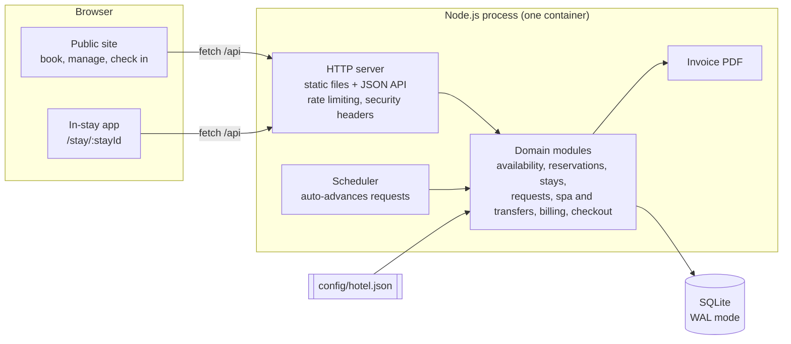
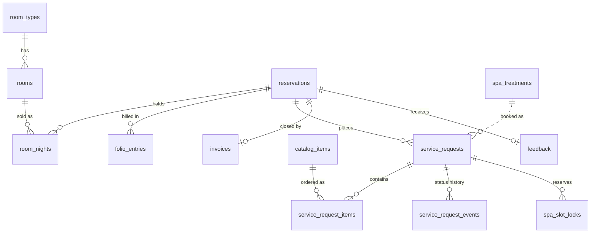

# White-label Hotel Guest Platform

A single web app that covers a hotel guest's whole stay without a login: **book a room → check in online → order services to the room → see a live bill → check out and download the invoice**. It ships with a demo hotel, *Saffron Bay Hotel & Spa* in Dubai, and every brand detail, price, tax and service comes from one config file, so it can be re-branded for another property.

## The guest journey

| Step | What the guest does | Where |
| --- | --- | --- |
| 1. Book | Search dates, pick a room type, enter details, guarantee with a (test) card, get a booking reference such as `SB-7K3QXA` | `/`, `/rooms`, `/book/:roomType` |
| 2. Check in online | Booking reference + last name, ID details. Gets a room number and a **Stay ID** such as `UX7E-MCVN-TKAP` | `/check-in` |
| 3. In-stay app | Opened with the Stay ID on any device, mobile-first | `/stay/:stayId` |
| | In-room dining with a cart, laundry (regular or express), housekeeping, free amenities, report a maintenance issue | |
| | Spa booking by time slot, airport transfer (to or from DXB/DWC, by car type) | |
| | Hotel info: Wi-Fi password, opening hours, house rules, local guide | |
| | Live status for every request, live itemised bill with taxes | |
| 4. Check out | Pays the balance, unused nights released for early departures, PDF tax invoice, star rating | `/stay/:stayId/checkout` |

Other pages: **Manage booking** (`/manage`) to look up or cancel a booking or recover a lost Stay ID.

Test card: `4242 4242 4242 4242`, any future expiry, any CVC. No real payment is taken.

## Run it

Requires Node.js 22.13 or newer (it uses the built-in `node:sqlite`).

```bash
npm install
npm run build
npm start            # http://localhost:3000
```

For development with auto-rebuild and server restart: `npm run dev`.

Reset the demo database: `npm run seed:reset`, or start with `RESET_DB_ON_START=true`.

## Configuration

### Auto-progress timers (env)

There is no staff panel in this version. A scheduler plays the hotel team and moves each request to its next status after a delay you set in the environment:

| Variable | Default | Meaning |
| --- | --- | --- |
| `AUTO_ADVANCE_ENABLED` | `true` | Turn the simulated staff on or off |
| `AUTO_ADVANCE_SECONDS` | `60` | Default time a request stays in each status |
| `AUTO_ADVANCE_SECONDS_FOOD`, `_LAUNDRY`, `_HOUSEKEEPING`, `_AMENITY`, `_MAINTENANCE`, `_SPA`, `_TRANSFER` | default | Per-service override |
| `AUTO_ADVANCE_TICK_SECONDS` | `5` | How often the scheduler checks for due requests |
| `HOUSEKEEPING_TURNAROUND_SECONDS` | `300` | A room left dirty at check-out becomes clean after this |

Spa treatments and transfers move to *completed* when their booked time slot ends, not on the timer.

Other variables (`PORT`, `DATABASE_PATH`, `EARLY_CHECKIN_DAYS`, `RATE_LIMIT_PER_MINUTE`, …) are listed in [`.env.example`](.env.example). `npm start` and `npm run dev` read a `.env` file if there is one.

### White-label config

[`config/hotel.json`](config/hotel.json) holds everything that is specific to a property: brand name and colours, contact details, check-in and check-out times, weekend pricing, the tax rules, Wi-Fi, opening hours, house rules, the local guide, room types and room numbers, the dining menu, laundry price list, amenities, housekeeping options, maintenance categories, spa treatments and opening hours, and transfer airports and car prices. It is validated with Zod at start-up, so a typo fails fast with a clear message. Point `HOTEL_CONFIG_PATH` at another file to run a different hotel; the brand colours are injected into the page server-side, and the illustrations are drawn in code from those colours.

## Architecture



- **One deployable.** A Node server serves the React bundle and the JSON API, and runs the scheduler. One URL, one container.
- **Frontend.** React 19 + TypeScript, bundled with esbuild. A small history router and hand-written CSS keep dependencies to React only. The in-stay app polls for live status every few seconds.
- **Backend.** TypeScript on Node's built-in `http` and `node:sqlite`; Zod validates every request body. Modules receive an `AppContext` (database, config, hotel, clock), so tests run against an in-memory database and a fake clock.

### Design decisions worth knowing

| Concern | Decision |
| --- | --- |
| No double bookings | Every sold room-night is a row in `room_nights` with primary key `(room_id, night)`. Bookings run in a `BEGIN IMMEDIATE` transaction, and the key rejects a second sale even if application code were wrong. On Postgres this becomes an `EXCLUDE USING gist` constraint on a date range. |
| Money | Integers in minor units (fils); no floats. |
| Ledger | `folio_entries` is append-only, enforced by database triggers. Cancellations and early departures add negative adjustment rows; nothing is edited or deleted. |
| Taxes | A small rules engine applies taxes in configured order; a tax can compound on earlier ones. The demo is set up like Dubai: 10% service charge, 7% municipality fee on room and food, AED 15 Tourism Dirham per room night, and 5% VAT on top of all of them. Each tax is rounded once. |
| Frozen invoice | At check-out the bill is snapshotted into `invoices`; the final bill is read from the snapshot, never recalculated. |
| Request lifecycle | Each service is a linear state machine (`received → preparing → on_the_way → delivered` for dining). Every transition is written to `service_request_events`, so the timeline is auditable. |
| Spa capacity | Three treatment rooms × 30-minute slots, locked in `spa_slot_locks` with a primary key, so a slot can't be over-sold. |
| No login, still safe | A booking needs reference + last name. The Stay ID has about 59 bits of randomness, works only for that stay, and repeated failed lookups are rate-limited per IP. The Wi-Fi password is only returned to checked-in stays. Only the last 4 digits of the card and of the ID document are stored. |
| Time | Stay dates are hotel-local calendar dates (`Asia/Dubai` from config); system timestamps are UTC. |

### Data model



### API

All endpoints are JSON under `/api`. Errors look like `{ "error": { "code": "sold_out", "message": "…" } }`.

| Method | Path | Purpose |
| --- | --- | --- |
| GET | `/hotel` | Brand, policies, room types |
| GET | `/availability?checkIn&checkOut&adults&children` | Rooms left and nightly prices per room type |
| POST | `/reservations` | Book (card guarantee) |
| GET | `/reservations/:code?lastName=` | Look up a booking |
| POST | `/reservations/:code/cancel` | Cancel before check-in |
| POST | `/check-in` | Online check-in, returns the stay and its Stay ID |
| GET | `/stays/:stayId` | Stay summary and balance |
| GET | `/stays/:stayId/info` | Wi-Fi, hours, house rules, local guide |
| GET | `/stays/:stayId/catalog/:service` | Menu or list for `food`, `laundry`, `amenity`, `housekeeping` |
| GET | `/stays/:stayId/options` | Spa treatments, transfer cars, maintenance categories |
| POST | `/stays/:stayId/orders/:service` | Place an order or request |
| POST | `/stays/:stayId/maintenance` | Report an issue |
| GET | `/stays/:stayId/spa/slots?date&treatmentId` | Free start times |
| POST | `/stays/:stayId/spa` | Book a treatment |
| POST | `/stays/:stayId/transfers` | Book an airport transfer |
| GET | `/stays/:stayId/requests` | All requests with status timeline |
| POST | `/stays/:stayId/requests/:id/cancel` | Cancel while still allowed |
| GET | `/stays/:stayId/bill` | Live itemised bill with taxes |
| POST | `/stays/:stayId/checkout` | Pay and check out, returns the invoice |
| GET | `/stays/:stayId/invoice`, `/stays/:stayId/invoice.pdf` | Invoice as JSON or PDF |
| POST | `/stays/:stayId/feedback` | Rating after check-out |
| GET | `/health` | Health check |

## Tests

```bash
npm test          # 20 unit and integration tests, in-memory database and a fake clock
npm run typecheck
npm run e2e       # full guest journey in headless Chromium, with screenshots (app must be running)
```

The tests cover overbooking prevention (in code and at the database level), weekend pricing, the tax stack and rounding, check-in windows, orders posting to the folio, per-service auto-advance timings, cancellation rules, spa capacity and lead time, transfer validation, early check-out with released nights and refunded spa, invoice freezing, the append-only ledger, and the housekeeping turnaround.

CI (GitHub Actions) runs typecheck, tests, build and the browser journey on every push.

## Deploy

The [`Dockerfile`](Dockerfile) runs the tests, builds, and ships a small image with only the bundle and the hotel config, with no `node_modules` at runtime.

**Render (free):** Dashboard → New → Blueprint → select this repository. [`render.yaml`](render.yaml) sets up the web service, health check and timer variables. On the free plan the SQLite file is wiped when the service restarts, so the demo data resets; attach a disk on a paid plan to keep it.

Any Docker host works the same way (Railway, Fly.io, a VM): build the image, set the env variables, and mount a volume at `/data` to keep the database.

## Project layout

```
config/hotel.json          white-label configuration (the demo hotel)
src/shared/types.ts        API types shared by server and client
src/server/
  config/                  env + hotel config loading and validation
  db/                      SQLite wrapper, migrations, seed
  http/                    server, router, routes
  modules/                 availability, reservations, stays, requests (workflows, scheduler),
                           scheduled services (spa, transfers), billing (folio, tax, PDF), checkout
src/client/
  pages/                   public site pages
  pages/stay/              in-stay app
  components/, lib/        UI pieces, router, API client, formatting
tests/                     node:test suites and the e2e journey
```

## Not in this version

These were scoped out of the two-day MVP and are the natural next steps:

- Staff and admin console (front desk, housekeeping board, kitchen queue) replacing the auto-progress timer
- Multi-property and multi-tenant white-label (tenant id on every table, per-tenant domains and theming)
- Real payment gateway with hosted card fields and tokenisation
- Channel manager and OTA sync, rate plans and restrictions, dynamic pricing
- Email, SMS and WhatsApp notifications; push updates instead of polling
- Arabic UI with right-to-left layout
- Postgres for multi-instance deployments, with a job queue for the scheduler
