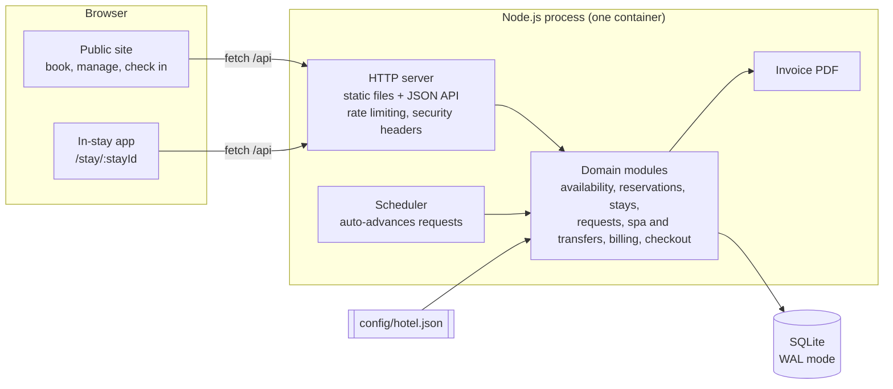
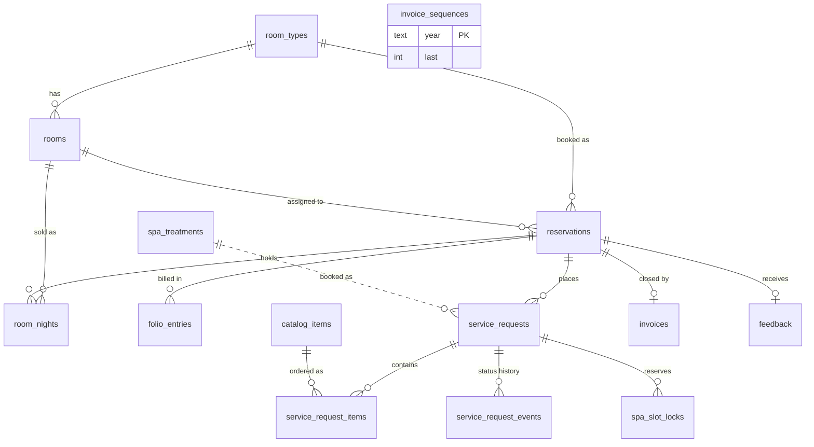

# White-label Hotel Guest Platform

I built a single web app that covers a hotel guest's whole stay without a login: **book a room → check in online → order services to the room → see a live bill → check out and download the invoice**. It ships with a fictional demo hotel, *Saffron Bay Hotel & Spa* in Dubai, and every brand detail, price, tax and service comes from one config file, so it can be re-branded for another property.

| | |
| --- | --- |
| **Live demo** | https://white-label-hms.onrender.com (test card `4242 4242 4242 4242`, expiry `12/29`, CVC `123`) |
| **User guide** | [Step-by-step walkthrough with screenshots](docs/14-user-guide.md#141-guest-guide) |
| **Documentation** | [All 14 design and project documents](docs/README.md) |

The demo runs on a free hosting plan. The app keeps its server awake, and its data is cleared only when I deploy a new version.

Works on any screen from a 320 px phone to a desktop; the in-stay app is designed for phones.

## Documentation

My design and project documentation is in [`docs/`](docs/README.md):

| # | Document | # | Document |
| --- | --- | --- | --- |
| 1 | [High-level design](docs/01-high-level-design.md) | 8 | [Security and privacy](docs/08-security-privacy.md) |
| 2 | [Low-level design](docs/02-low-level-design.md) | 9 | [Performance and scalability](docs/09-performance-scalability.md) |
| 3 | [Database design and schema](docs/03-database-design.md) | 10 | [Testing and test report](docs/10-testing.md) |
| 4 | [Deployment and DevOps](docs/04-deployment-devops.md) | 11 | [Architecture decision records](docs/11-decision-records.md) |
| 5 | [Requirements](docs/05-requirements.md) | 12 | [Runbook](docs/12-runbook.md) |
| 6 | [API specification](docs/06-api-specification.md) | 13 | [Limitations and future scope](docs/13-limitations-future-scope.md) |
| 7 | [UI/UX design](docs/07-ui-ux-design.md) | 14 | [User guide](docs/14-user-guide.md) |


## The guest journey

| Step | What the guest does | Where |
| --- | --- | --- |
| 1. Book | Search dates, pick a room type, enter details, guarantee with a (test) card, get a booking reference such as `SB-7K3QXA` | `/`, `/rooms`, `/book/:roomType` |
| 2. Check in online | Booking reference + last name, ID details. Gets a room number and a **Stay ID** such as `UX7E-MCVN-TKAP` | `/check-in` |
| 3. In-stay app | Opened with the Stay ID on any device, mobile-first | `/stay/:stayId` |
| | In-room dining with a cart, laundry (regular or express), housekeeping, free amenities, report a maintenance issue | |
| | Spa booking by time slot, airport transfer (to or from DXB/DWC, by car type) | |
| | Hotel info: Wi-Fi password, opening hours, house rules, local guide | |
| | Live status for every request, live itemised bill with taxes | |
| 4. Check out | Sees the exact amount first, then pays; leaving early releases unused nights and refunds spa bookings not yet started and transfers booked for a later day; PDF tax invoice, star rating | `/stay/:stayId/checkout` |

Other pages: **Manage booking** (`/manage`) to look up or cancel a booking, recover a lost Stay ID or reopen the invoice after check-out. Step-by-step screenshots are in the [user guide](docs/14-user-guide.md).

Test card: `4242 4242 4242 4242`, any expiry from the current month on, any CVC. No real payment is taken.

## Running it

The app needs Node.js 22.13 or newer (it uses the built-in `node:sqlite`). I run it locally with:

```bash
npm install
npm run build
npm start            # http://localhost:3000
```

`npm ci` replaces `npm install` once a `package-lock.json` is committed. `npm run dev` rebuilds the client and restarts the server on every change. `npm run seed:reset`, or starting with `RESET_DB_ON_START=true`, resets the demo database.

## Configuration

### Auto-progress timers (env)

This version has no staff panel. A scheduler plays the hotel team and moves each request to its next status after a delay set in the environment:

| Variable | Default | Meaning |
| --- | --- | --- |
| `AUTO_ADVANCE_ENABLED` | `true` | Turn the simulated staff on or off |
| `AUTO_ADVANCE_SECONDS` | `10` | Default time a request stays in each status |
| `AUTO_ADVANCE_SECONDS_FOOD`, `_LAUNDRY`, `_HOUSEKEEPING`, `_AMENITY`, `_MAINTENANCE`, `_SPA`, `_TRANSFER` | default | Per-service override |
| `AUTO_ADVANCE_TICK_SECONDS` | `2` | How often the scheduler checks for due requests |
| `HOUSEKEEPING_TURNAROUND_SECONDS` | `300` | A room left dirty at check-out becomes clean after this |

With the defaults a dining order goes received → preparing → on the way → delivered in about 30 seconds. Spa treatments and transfers move to *completed* when their booked time slot ends, not on the timer.

Other variables (`PORT`, `DATABASE_PATH`, `EARLY_CHECKIN_DAYS`, `RATE_LIMIT_PER_MINUTE`, `TRUST_PROXY_HOPS`, …) are listed in [`.env.example`](.env.example) and the [configuration reference](docs/04-deployment-devops.md#45-configuration-reference). `npm start` and `npm run dev` read a `.env` file if there is one.

### White-label config

[`config/hotel.json`](config/hotel.json) holds everything that is specific to a property: brand name and colours, contact details, check-in and check-out times, weekend pricing, the tax rules, Wi-Fi, opening hours, house rules, the local guide, room types and room numbers, the dining menu, laundry price list, amenities, housekeeping options, maintenance categories, spa treatments and opening hours, and transfer airports and car prices. It is validated with Zod at start-up, so a typo fails fast with a clear message. `HOTEL_CONFIG_PATH` pointing at another file runs a different hotel; the brand colours are injected into the page server-side, and the illustrations are drawn in code from those colours. The [operator guide](docs/14-user-guide.md#142-operator-guide) describes every section.

## Architecture

Details: [high-level design](docs/01-high-level-design.md) and [low-level design](docs/02-low-level-design.md).



- **One deployable.** A Node server serves the React bundle and the JSON API, and runs the scheduler. One URL, one container.
- **Frontend.** React 19 + TypeScript, bundled with esbuild. A small history router and hand-written CSS keep dependencies to React only. The in-stay app polls for live status every few seconds.
- **Backend.** TypeScript on Node's built-in `http` and `node:sqlite`; Zod validates every request body. Modules receive an `AppContext` (database, config, hotel, clock), so tests run against an in-memory database and a fake clock.

### Key design decisions

My reasoning and the alternatives I considered are in the [decision records](docs/11-decision-records.md).

| Concern | Decision |
| --- | --- |
| No double bookings | Every sold room-night is a row in `room_nights` with primary key `(room_id, night)`. Bookings run in a `BEGIN IMMEDIATE` transaction, and the key rejects a second sale even if application code were wrong. On Postgres this becomes an `EXCLUDE USING gist` constraint on a date range. |
| Money | Integers in minor units (fils); no floats, percentages included. Invoice numbers come from a per-year counter. |
| Ledger | `folio_entries` is append-only, enforced by database triggers. Cancellations and early departures add negative adjustment rows; nothing is edited or deleted. |
| Taxes | A small rules engine applies taxes in configured order; a tax can compound on earlier ones. The demo is set up like Dubai: 10% service charge, 7% municipality fee on room and food, AED 15 Tourism Dirham per room night, and 5% VAT on top of all of them. Each tax is rounded once. |
| Check-out | A preview runs the real check-out in a transaction and rolls it back, so the amount on the button is the amount charged. At check-out the bill is snapshotted into `invoices`; the final bill is read from the snapshot, never recalculated. |
| Request lifecycle | Each service is a linear state machine (`received → preparing → on_the_way → delivered` for dining). Every transition is written to `service_request_events`, so the timeline is auditable. |
| Spa capacity | Three treatment rooms × 30-minute slots, locked in `spa_slot_locks` with a primary key, so a slot can't be over-sold. |
| No login, still safe | A booking needs reference + last name. The Stay ID has about 59 bits of randomness, works only for that stay, and repeated lookups of codes that do not exist are rate-limited per client address (taken from the trusted proxy's `X-Forwarded-For` entry). The Wi-Fi password is only returned to checked-in stays. Only the last 4 digits of the card and of the ID document are stored. |
| Time | Stay dates are hotel-local calendar dates (`Asia/Dubai` from config); system timestamps are UTC. New requests close at check-out time on the last day. |

### Data model

Every table and column is described in the [database design](docs/03-database-design.md).



### API

All endpoints are JSON under `/api`. Errors look like `{ "error": { "code": "sold_out", "message": "…" } }`. Request and response examples, validation rules and error codes are in the [API specification](docs/06-api-specification.md).

| Method | Path | Purpose |
| --- | --- | --- |
| GET | `/hotel` | Brand, policies, room types |
| GET | `/availability?checkIn&checkOut&adults&children` | Rooms left and nightly prices per room type |
| POST | `/reservations` | Book (card guarantee) |
| GET | `/reservations/:code?lastName=` | Look up a booking |
| POST | `/reservations/:code/cancel` | Cancel before check-in |
| POST | `/check-in` | Online check-in, returns the stay and its Stay ID |
| GET | `/stays/:stayId` | Stay summary and balance |
| GET | `/stays/:stayId/info` | Wi-Fi, hours, house rules, local guide |
| GET | `/stays/:stayId/catalog/:service` | Menu or list for `food`, `laundry`, `amenity`, `housekeeping` |
| GET | `/stays/:stayId/options` | Spa treatments, transfer cars, maintenance categories |
| POST | `/stays/:stayId/orders/:service` | Place an order or request |
| POST | `/stays/:stayId/maintenance` | Report an issue |
| GET | `/stays/:stayId/spa/slots?date&treatmentId` | Free start times |
| POST | `/stays/:stayId/spa` | Book a treatment |
| POST | `/stays/:stayId/transfers` | Book an airport transfer |
| GET | `/stays/:stayId/requests` | All requests with status timeline |
| POST | `/stays/:stayId/requests/:id/cancel` | Cancel while still allowed |
| GET | `/stays/:stayId/bill` | Live itemised bill with taxes |
| GET | `/stays/:stayId/checkout-preview` | What check-out would charge and release, without changing anything |
| POST | `/stays/:stayId/checkout` | Pay and check out, returns the invoice |
| GET | `/stays/:stayId/invoice`, `/stays/:stayId/invoice.pdf` | Invoice as JSON or PDF |
| POST | `/stays/:stayId/feedback` | Rating after check-out |
| GET | `/health` | Health check |

## Tests

```bash
npm test                 # 31 unit, integration and HTTP tests, in-memory database and a fake clock
npm run typecheck
npm run e2e              # full guest journey in headless Chromium, with screenshots (app must be running)
npm run e2e:responsive   # 12 pages x 8 screen sizes (320-1920 px): no sideways scrolling, no tiny controls
```

The tests cover overbooking prevention (in code and at the database level), weekend pricing, the tax stack and rounding, check-in windows, orders posting to the folio, per-service auto-advance timings, cancellation rules, spa capacity and lead time, transfer validation, early check-out with released nights and refunded spa, invoice freezing and per-year numbering, the check-out preview, the end-of-stay rules, the append-only ledger, the housekeeping turnaround, and the HTTP layer (malformed addresses, content type, proxy address, lookup limits).

CI (GitHub Actions) runs typecheck, tests, build, the browser journey, the responsive check and a Docker image build on every push. The test catalogue and the results of testing the live site are in [Testing and test report](docs/10-testing.md).

## Deploy

The [`Dockerfile`](Dockerfile) runs the tests, builds, and ships a small image with only the bundle and the hotel config, with no `node_modules` at runtime.

**Render (free):** I deploy through the Render Blueprint in [`render.yaml`](render.yaml), which sets up the web service, health check and timer variables; every push to `main` redeploys. The free plan has no persistent disk, so the SQLite file is cleared on each deploy or restart. Render stops free services after 15 minutes without traffic, so the app requests its own `/api/health` every 10 minutes (`KEEP_ALIVE_MINUTES`) to stay awake and keep its data between deploys. A paid plan with a disk keeps data across deploys too.

The same image runs on any Docker host (Railway, Fly.io, a VM) with the env variables set and a volume at `/data` for the database. Environments, CI/CD, backup and rollback are in [Deployment and DevOps](docs/04-deployment-devops.md); everyday tasks and troubleshooting are in the [runbook](docs/12-runbook.md).

## Project layout

```
config/hotel.json          white-label configuration (the demo hotel)
docs/                      design and project documentation (14 documents + screenshots)
src/shared/types.ts        API types shared by server and client
src/server/
  index.ts, context.ts     start-up and shutdown; AppContext (db, config, hotel, clock)
  keep-alive.ts            self-ping that keeps the free Render service awake
  config/                  env + hotel config loading and validation
  db/                      SQLite wrapper, migrations, seed, reset
  http/                    server, router, routes
  lib/                     errors, money, time, codes, rate limiting
  modules/                 availability, reservations, stays, requests (workflows, scheduler),
                           scheduled services (spa, transfers), billing (folio, tax, PDF), checkout
src/client/
  pages/                   public site pages
  pages/stay/              in-stay app
  components/, lib/        UI pieces, error boundary, router, API client, formatting, live region
  index.html, styles.css   page shell and all styles (brand colours as CSS variables)
public/                    static files (favicon)
scripts/                   build and dev scripts (esbuild)
tests/                     node:test suites (booking, stay, tax, hardening) and shared helpers
tests/e2e/                 browser journey and responsive check (Playwright)
.github/workflows/ci.yml   CI pipeline
Dockerfile, render.yaml    container image and Render Blueprint
```

## Not in this version

I scoped these out of the two-day MVP; they are the next phases of my roadmap. The full list of limitations, their impact and the phases are in [Limitations and future scope](docs/13-limitations-future-scope.md).

- Staff and admin console (front desk, housekeeping board, kitchen queue) replacing the auto-progress timer
- Multi-property and multi-tenant white-label (tenant id on every table, per-tenant domains and theming)
- Real payment gateway with hosted card fields and tokenisation
- Channel manager and OTA sync, rate plans and restrictions, dynamic pricing
- Email, SMS and WhatsApp notifications; push updates instead of polling
- Arabic UI with right-to-left layout
- Postgres for multi-instance deployments, with a job queue for the scheduler
