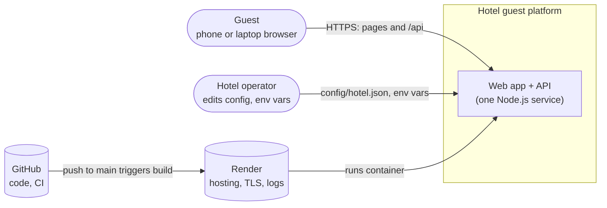
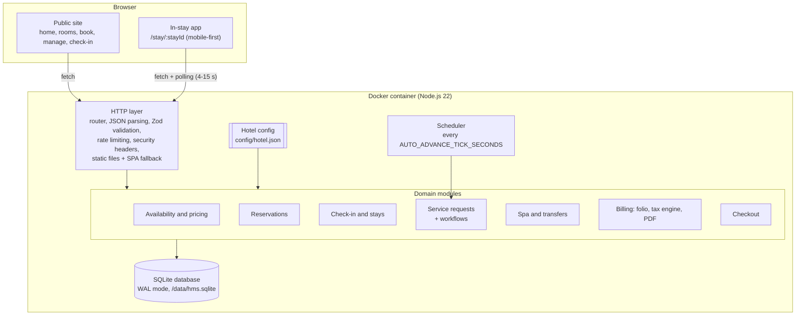
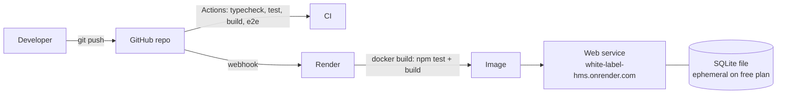
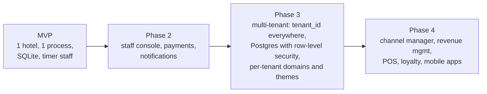

# 1. High-level design (HLD)

**Status:** reflects the MVP in this repository (single hotel, guest-facing, no staff console).
**Related:** [LLD](02-low-level-design.md), [Database](03-database-design.md), [Deployment](04-deployment-devops.md), [Decisions](11-decision-records.md)

## 1.1 Purpose and scope

The system lets a hotel guest run their whole stay from a browser, with no app install and no account:

1. book a room
2. check in online
3. order services to the room (dining, laundry, housekeeping, amenities, maintenance, spa, airport transfer)
4. follow each request's status and a live bill
5. check out, pay and download a tax invoice

It is **white-label**: the brand, policies, prices, taxes and service catalogue of the property come from one configuration file, so the same code can run a different hotel.

**Out of scope for the MVP** (see [Limitations and future scope](13-limitations-future-scope.md)): staff and admin console, multiple properties, real payment gateway, notifications, channel manager.

## 1.2 System context

Who and what the system talks to.

There are no outbound integrations in the MVP. Payment, email/SMS, door locks and OTAs are listed as future integrations in [section 13](13-limitations-future-scope.md).

## 1.3 Containers and components

Everything runs in **one process in one container**: the static web client, the JSON API, the background scheduler and the database file.

| Component | Responsibility | Technology |
| --- | --- | --- |
| Web client | All pages, routing, forms, polling for live status | React 19, TypeScript, esbuild, hand-written CSS |
| HTTP layer | Routing, body parsing (64 KB cap), validation, errors, rate limits, headers, static files | Node `http` module, Zod |
| Domain modules | Business rules: availability, booking, check-in, requests, spa/transfer slots, billing, checkout | TypeScript, plain functions over an `AppContext` |
| Scheduler | Simulated staff: advances due requests; cleans rooms after turnaround | `setInterval` in the same process |
| Database | Durable state, integrity constraints (no double booking, append-only ledger) | SQLite via built-in `node:sqlite` |
| Hotel config | White-label surface: brand, policies, taxes, catalogue | JSON validated by Zod at start-up |
| Invoice renderer | Tax invoice as PDF | pdf-lib |

## 1.4 Key flows (summary)

Detailed sequence diagrams are in the [LLD](02-low-level-design.md#24-sequence-diagrams).

| Flow | What happens | Guarantees |
| --- | --- | --- |
| Search | Count free rooms per room type for the date range; price each night (weekend uplift) | Read-only |
| Book | In one write transaction: pick a free room, create the reservation, insert one `room_nights` row per night | A room-night can be sold once (primary key) |
| Check in | Booking reference + last name; window check; issue Stay ID; post one room charge per night | Idempotent for the same booking |
| Order a service | Validate items against the catalogue, snapshot prices, create the request and its first status, post charges | All in one transaction |
| Auto-progress | Scheduler finds requests whose `next_transition_at` has passed and moves each one stage on | Each move is conditional on the expected stage (no double moves) |
| Check out | Release unused nights, cancel future spa and later-day transfers, post taxes and payment, freeze an invoice, close the stay, mark the room dirty | One transaction; a stay closes once |

## 1.5 Technology choices

| Area | Choice | Why (short) | Record |
| --- | --- | --- | --- |
| Runtime | Node.js 22 + TypeScript | One language front to back; shared API types | — |
| Database | SQLite (`node:sqlite`) | Zero setup, real SQL constraints and transactions, one file to deploy | [ADR-01](11-decision-records.md#adr-01-sqlite-for-the-mvp-postgres-later) |
| Deployable | One service serving UI, API and scheduler | One URL, one deploy, nothing to wire for a demo | [ADR-02](11-decision-records.md#adr-02-one-deployable) |
| Guest identity | Booking reference + last name, then a Stay ID | No passwords to manage; matches how hotels identify guests | [ADR-03](11-decision-records.md#adr-03-no-login-booking-reference-and-stay-id) |
| Live status | Polling every 4–15 s | Simple and robust; fine at this scale | [ADR-04](11-decision-records.md#adr-04-polling-instead-of-push) |
| Billing | Append-only ledger + frozen invoice | Auditability; corrections never rewrite history | [ADR-05](11-decision-records.md#adr-05-append-only-folio-and-frozen-invoice) |
| Staff actions | Timer-driven auto-progress | Demo without a staff console; durations set in env | [ADR-06](11-decision-records.md#adr-06-timer-driven-auto-progress-instead-of-a-staff-console) |
| Frontend libs | React only; own router and CSS | Small bundle, nothing to learn but React | [ADR-07](11-decision-records.md#adr-07-minimal-frontend-dependencies) |

## 1.6 Cross-cutting concerns

| Concern | Approach | Detail |
| --- | --- | --- |
| Security | Unguessable Stay ID, rate-limited failed lookups, CSP and other headers, minimal PII | [Security](08-security-privacy.md) |
| Money | Integer minor units (fils); taxes rounded once per tax | [LLD 2.6](02-low-level-design.md#26-billing-and-tax-engine) |
| Time | Stay dates in the hotel time zone (`Asia/Dubai`); timestamps in UTC | [LLD 2.8](02-low-level-design.md#28-time-handling) |
| Configuration | Env vars for runtime behaviour; `hotel.json` for the property | [Deployment 4.5](04-deployment-devops.md#45-configuration-reference) |
| Observability | One JSON log line per API request and per scheduler action; `/api/health` | [Runbook](12-runbook.md) |
| Testing | 20 unit/integration tests on a fake clock; browser journey with Playwright | [Testing](10-testing.md) |

## 1.7 Deployment view

Details, environments and rollback are in [Deployment and DevOps](04-deployment-devops.md).

## 1.8 Evolution to the full white-label HMS

The MVP is deliberately one hotel and one process. The path to the multi-tenant platform described in the PRD:

What changes architecturally at each step is detailed in [Limitations and future scope](13-limitations-future-scope.md) and [Performance and scaling](09-performance-scalability.md).
