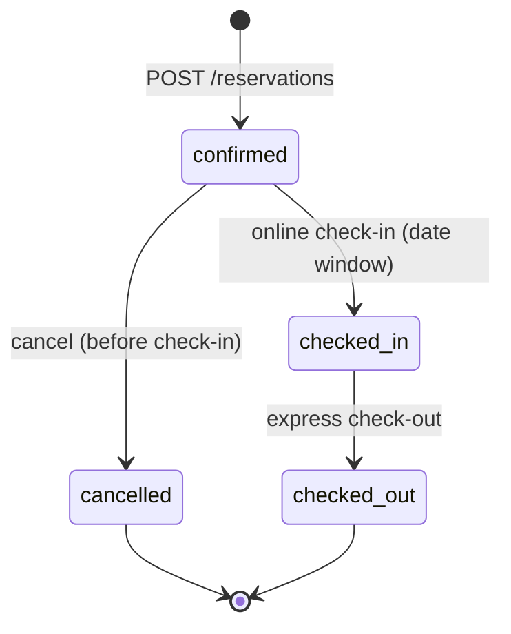
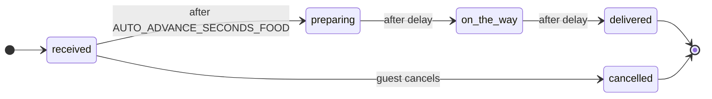
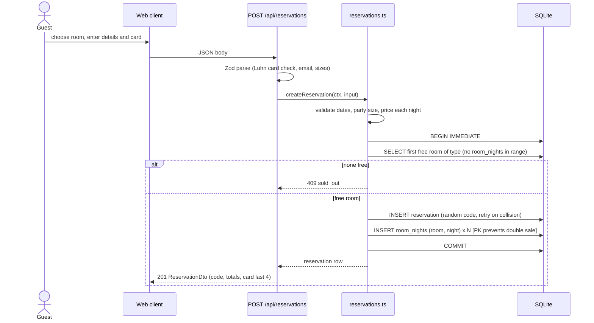
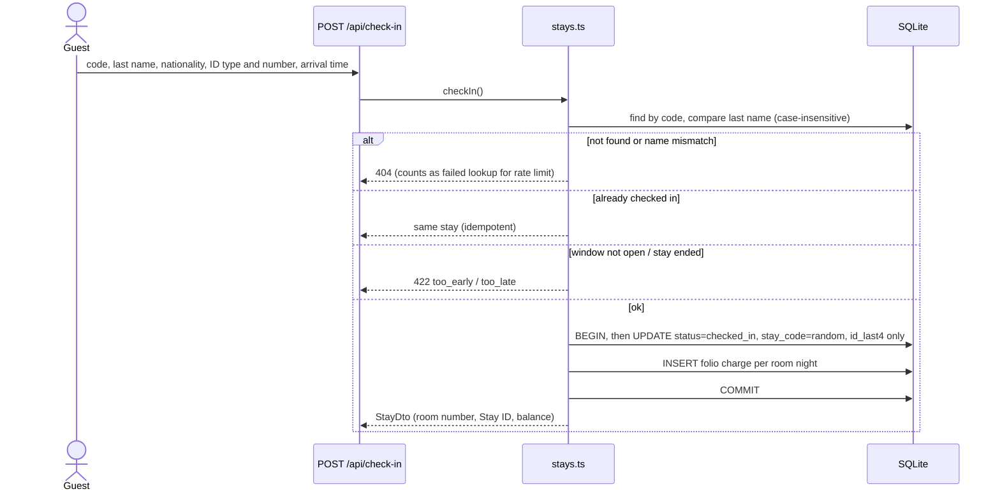
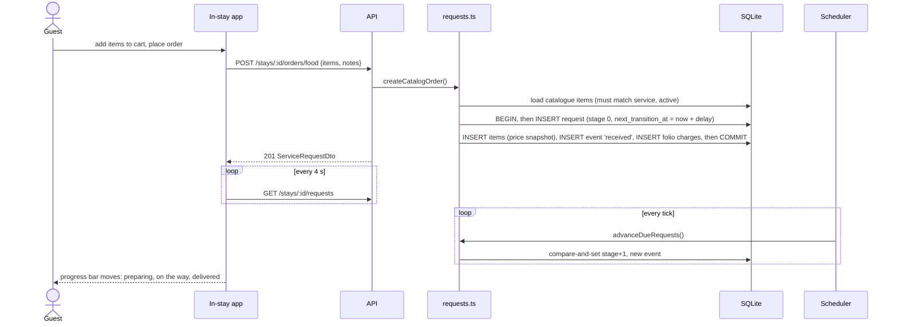
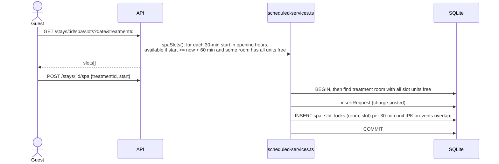
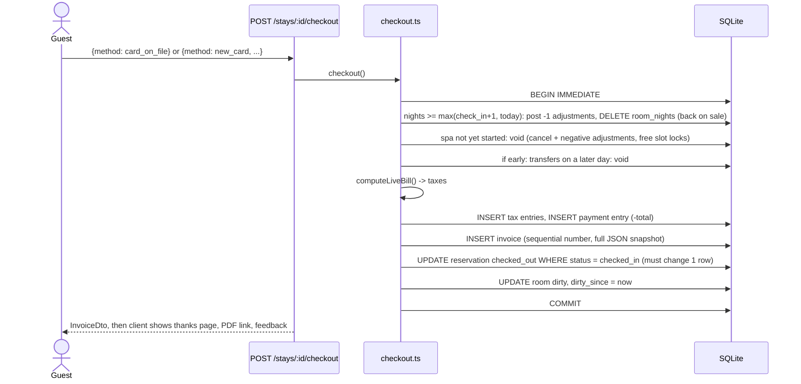

# 2. Low-level design (LLD)

**Related:** [HLD](01-high-level-design.md), [Database](03-database-design.md), [API](06-api-specification.md)

## 2.1 Code structure

```
src/
  shared/types.ts                 API types used by both server and client (single source of truth)
  server/
    index.ts                      bootstrap: config, DB, seed, scheduler, HTTP server, graceful shutdown
    context.ts                    AppContext { db, config, hotel, clock }, today(), nowIso()
    config/env.ts                 env vars -> AppConfig (Zod), incl. auto-advance timers
    config/hotel.ts               hotel.json -> HotelConfig (Zod), white-label surface
    db/database.ts                Db wrapper over node:sqlite: run/get/all, tx() with savepoints
    db/migrations.ts              numbered forward-only migrations
    db/seed.ts                    rooms + catalogue from hotel.json into an empty DB
    http/router.ts                tiny regex router, parse(schema, data) -> 400 on invalid input
    http/routes.ts                every endpoint, thin: parse -> module call -> DTO
    http/server.ts                node:http server, JSON body, errors, rate limits, headers, static + SPA
    lib/                          errors, money, time, codes, rate-limit (pure helpers)
    modules/
      rooms.ts                    room types, nightly pricing
      availability.ts             date validation, free rooms, search
      reservations.ts             create / find / cancel booking, DTO
      stays.ts                    check-in, Stay lookup, stay info, feedback
      requests/workflows.ts       per-service state machines
      requests/requests.ts        create orders, maintenance, list, cancel, void, auto-advance
      requests/scheduler.ts       interval loop that calls advanceDueRequests()
      scheduled-services.ts       spa slots and booking, airport transfers
      billing/folio.ts            post entries, live bill, frozen bill
      billing/tax.ts              tax rules engine (pure)
      billing/invoice-pdf.ts      PDF rendering
      checkout.ts                 express check-out transaction, invoice
  client/
    main.tsx, App.tsx             entry and top-level routing
    lib/                          router, API client + useApi hook, formatting, hotel context
    components/                   layout, search form, illustrations, icons, form pieces
    pages/                        public site pages
    pages/stay/                   in-stay app pages
```

**Layering rule:** `http` → `modules` → `db`/`lib`. Modules never import from `http`; the client only imports types from `shared`.

## 2.2 Dependency injection: `AppContext`

Every module function takes an `AppContext` as its first argument instead of importing globals:

```ts
interface AppContext {
  db: Db;            // SQLite wrapper
  config: AppConfig; // env: timers, limits, paths
  hotel: HotelConfig;// white-label config
  clock: Clock;      // now(); systemClock in prod, FixedClock in tests
}
```

This is what lets the tests run each scenario against a fresh in-memory database and move time forward deterministically (`clock.advanceSeconds(61)`), with no mocking library.

## 2.3 State machines

### Reservation lifecycle



| Transition | Guard | Side effects |
| --- | --- | --- |
| → confirmed | dates valid, party fits room type, a room is free for every night, card passes Luhn | `room_nights` rows inserted, one per night |
| confirmed → cancelled | status is `confirmed` | `room_nights` deleted (inventory released) |
| confirmed → checked_in | `today ≥ check_in − EARLY_CHECKIN_DAYS` and `today < check_out` | Stay ID issued; one room charge per night posted to folio |
| checked_in → checked_out | status is `checked_in` (conditional update) | see [check-out sequence](#check-out) |

### Service request workflows

Each service is a linear state machine defined in `requests/workflows.ts`. `advance` says how a request leaves a stage.

| Service | Stages (→ advance rule) | Charged | Cancel allowed |
| --- | --- | --- | --- |
| food | received →delay→ preparing →delay→ on_the_way →delay→ delivered | yes | stage 0 only |
| laundry | received → picked_up → cleaning → delivered (all delay) | yes, +50% if express | stage 0 only |
| housekeeping | received → in_progress → completed | free | stage 0 only |
| amenity | received → on_the_way → delivered | free | stage 0 only |
| maintenance | reported → assigned → in_progress → resolved | free | stage 0 only |
| spa | requested →delay→ confirmed →**slot end**→ completed | yes | until 60 min before start |
| transfer | requested →delay→ confirmed →delay→ driver_assigned →**pickup + drive time**→ completed | yes | until 120 min before pickup |

`cancelled` is a separate terminal state reachable from any non-final stage when the rule allows.



**Timer resolution:** `delay = AUTO_ADVANCE_SECONDS_<SERVICE> ?? AUTO_ADVANCE_SECONDS` (default 10 s; the scheduler checks every `AUTO_ADVANCE_TICK_SECONDS`, default 2 s, so a dining order is delivered about 30 s after it is placed). For `scheduled_end` stages the next transition time is the slot end converted from hotel-local time to UTC.

### Auto-advance algorithm

```
every AUTO_ADVANCE_TICK_SECONDS:
  due = requests where next_transition_at <= now and status != cancelled  (max 500, oldest first)
  for each r in due (own transaction):
    stage' = r.stage + 1
    next'  = final(stage') ? NULL
           : advance(stage') == 'scheduled_end' ? scheduled_end_utc
           : now + delay(service)
    UPDATE ... SET stage = stage', status = ..., next_transition_at = next'
      WHERE id = r.id AND stage = r.stage        -- compare-and-set: never double-advances
    if 1 row changed: INSERT service_request_events(status, now)
  also: rooms dirty for >= HOUSEKEEPING_TURNAROUND_SECONDS -> clean
```

The partial index `service_requests_due (next_transition_at) WHERE next_transition_at IS NOT NULL` keeps the scan cheap: finished requests leave the index.

## 2.4 Sequence diagrams

### Booking



### Online check-in



### Ordering a service and auto-progress



### Spa booking



### Check-out



## 2.5 Availability and pricing

- **Valid dates:** `check_in >= today` (hotel time zone), `check_out > check_in`, at most `maxNights` (30), check-in within `bookingWindowDays` (365).
- **Free rooms of a type:** rooms not `out_of_order` with no `room_nights` row in `[check_in, check_out)`. Clean rooms are offered first, then by room number.
- **Nightly rate:** `base_rate_minor`, multiplied by `weekend.rateMultiplier` (1.2) for nights whose weekday is in `weekend.nights` (Thursday and Friday nights in the demo), rounded to the fil.
- **Room assignment** happens at booking time (a specific room), so availability is exact per night; the room number is only revealed after check-in.

## 2.6 Billing and tax engine

**Folio:** every money movement is a row in `folio_entries` with `kind` = `charge | adjustment | tax | payment`. Rows are never updated or deleted (database triggers abort such statements).

| Event | Entries posted |
| --- | --- |
| Check-in | `charge`, category `room`, one per night, `source_type = room_night` |
| Paid order (food, laundry, spa, transfer) | `charge` per item line (+ express surcharge line) |
| Cancel / void a request | `adjustment` with the negative amount of each original charge |
| Early departure | `adjustment` −1 × nightly rate per released night, `source_type = room_night` |
| Check-out | one `tax` entry per tax line, one `payment` entry (−total) |

**Live bill** = sum of `charge` + `adjustment` lines → subtotal → taxes computed by the engine → total − payments = balance.

**Tax engine** (`billing/tax.ts`, pure function) applies rules in configured order:

```
for rule in hotel.taxes:
  per_room_night: amount = rule.amount × chargedRoomNights      (nights net of releases)
  percent:        basis  = Σ lines in rule.appliesTo categories + Σ earlier taxes in rule.compoundOn
                  amount = round_half_away_from_zero(basis × rate / 100)
```

Demo configuration (Dubai-style): service charge 10% on everything, municipality fee 7% on room and food, Tourism Dirham AED 15 per room night, VAT 5% on everything **plus** service charge and municipality fee. Each tax is rounded once on its total, not per line.

**Frozen bill:** at check-out the full bill is stored as JSON in `invoices.payload`; `GET /bill` for a closed stay reads that snapshot, so a later config change (new tax rate) never alters a past invoice.

## 2.7 HTTP layer: validation, errors, limits

| Aspect | Design |
| --- | --- |
| Routing | Regex patterns with `:params`; 404 for unknown paths, 405 for wrong method |
| Body | JSON only (`415` otherwise), max 64 KB (`413`), invalid JSON `400` |
| Validation | Zod schema per endpoint; first issue becomes the message, all issues in `details.fields` |
| Errors | `HttpError(status, code, message)` thrown by modules; unknown errors logged with stack, `500 internal_error` returned without internals |
| Error shape | `{ "error": { "code": "sold_out", "message": "...", "details"?: ... } }` |
| Rate limits | per IP, fixed 60 s window: general budget `max(10 × RATE_LIMIT_PER_MINUTE, 120)` API calls; **failed lookups** (404 on booking/stay/check-in paths) limited to `RATE_LIMIT_PER_MINUTE`, after which lookups get `429` with `Retry-After` |
| Headers | CSP (`self` only), `X-Frame-Options: DENY`, `nosniff`, `Referrer-Policy: no-referrer`, `Permissions-Policy` |
| Static files | Hashed bundles cached 1 year (`immutable`); `index.html` `no-cache` with brand colours injected server-side; SPA fallback for extension-less paths |

## 2.8 Time handling

| Value | Representation | Example |
| --- | --- | --- |
| Stay dates | Hotel-local calendar date `YYYY-MM-DD` | `2026-11-19` |
| "Today" | Computed from the clock in `hotel.timezone` via `Intl` | `hotelToday(clock, 'Asia/Dubai')` |
| Spa / transfer times | Hotel-local wall clock `YYYY-MM-DDTHH:mm` | `2026-11-20T16:00` |
| System timestamps | UTC ISO 8601 | `2026-11-19T01:41:01.722Z` |

`hotelLocalToUtc()` converts wall-clock times to instants with a two-pass offset correction, so it also works for zones with daylight saving (Dubai has none, but a re-branded hotel might).

## 2.9 Identifiers

| Identifier | Format | Entropy | Notes |
| --- | --- | --- | --- |
| Booking reference | `SB-` + 6 chars | 31⁶ ≈ 8.9 × 10⁸ | Prefix from `brand.codePrefix`; always used with last name |
| Stay ID | `XXXX-XXXX-XXXX` | 31¹² ≈ 7.9 × 10¹⁷ (~59 bits) | Bearer key to the in-stay app; issued at check-in |
| Invoice number | `SB-INV-YYYY-NNNNN` | sequential | Allocated inside the check-out transaction |

The alphabet `ABCDEFGHJKMNPQRSTUVWXYZ23456789` drops look-alike characters (0/O, 1/I/L) so codes can be read over the phone. Codes come from `crypto.randomInt`, and inserts retry on the rare unique-key collision.

## 2.10 Frontend design

| Concern | Design |
| --- | --- |
| Routing | ~60-line history router (`useSyncExternalStore` on `popstate`); `/stay/*` renders the mobile app shell, everything else the website layout |
| Data fetching | `useApi(path, pollMs?)` hook: loading/error state, optional polling that pauses when the tab is hidden |
| Polling intervals | stay summary 15 s, requests 4 s, bill 10 s |
| State | Local component state; hotel data in a React context; Stay ID remembered in `localStorage`; the last booking in `sessionStorage` for the confirmation page |
| Theming | CSS variables `--brand`, `--accent`, `--surface`, `--ink`, `--brand-ink` injected into `index.html` by the server from `hotel.json` |
| Illustrations | SVG drawn in code from the brand variables (arch motif), so a new brand needs no new images |
| Accessibility | Labelled fields, visible focus ring, `aria-pressed` on toggles, `aria-live` on request status, reduced-motion respected |
