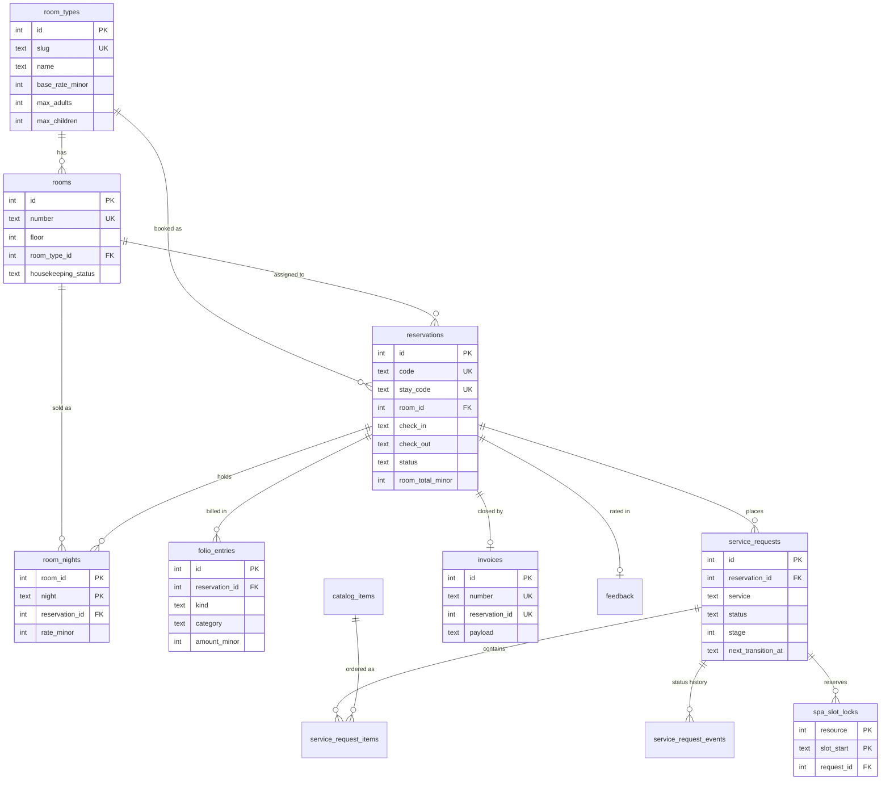

# 3. Database design and schema

**Engine:** SQLite 3 through Node's built-in `node:sqlite`, WAL journal, foreign keys on, 5 s busy timeout.
**Source of truth:** [`src/server/db/migrations.ts`](../src/server/db/migrations.ts)
**Related:** [LLD](02-low-level-design.md), [Decision ADR-01](11-decision-records.md#adr-01-sqlite-for-the-mvp-postgres-later)

## 3.1 Entity-relationship diagram



`spa_treatments` stands alone: a spa request copies the treatment name, duration and price into the request (`details`, items, charges) so later price changes never alter a booked treatment.

## 3.2 Data dictionary

Money columns are integers in **minor units** (fils: AED 1.00 = 100). Dates are text `YYYY-MM-DD` (hotel-local); `*_at` timestamps are UTC ISO strings unless noted.

### Inventory

**`room_types`**: sellable room categories, seeded from `hotel.json`

| Column | Type | Rules | Meaning |
| --- | --- | --- | --- |
| id | INTEGER | PK | |
| slug | TEXT | NOT NULL, UNIQUE | URL key, e.g. `sea-view-premier` |
| name, description, bed, view | TEXT | NOT NULL | Display text |
| base_rate_minor | INTEGER | ≥ 0 | Weekday nightly rate |
| max_adults | INTEGER | ≥ 1 | Capacity |
| max_children | INTEGER | ≥ 0 | Capacity |
| size_sqm | INTEGER | NOT NULL | |
| amenities | TEXT | JSON array | e.g. `["Balcony","Soaking tub"]` |
| sort | INTEGER | default 0 | Display order |

**`rooms`**: physical rooms

| Column | Type | Rules | Meaning |
| --- | --- | --- | --- |
| id | INTEGER | PK | |
| number | TEXT | NOT NULL, UNIQUE | `201` |
| floor | INTEGER | NOT NULL | Derived from the number when seeding |
| room_type_id | INTEGER | FK → room_types | |
| housekeeping_status | TEXT | `clean`, `dirty`, `out_of_order` | Dirty after check-out; out-of-order rooms are never sold |
| dirty_since | TEXT | UTC, nullable | Start of the turnaround timer |

### Bookings and stays

**`reservations`**: one booking, later one stay

| Column | Type | Rules | Meaning |
| --- | --- | --- | --- |
| id | INTEGER | PK | |
| code | TEXT | NOT NULL, UNIQUE | Booking reference `SB-XXXXXX` |
| stay_code | TEXT | UNIQUE, NULL until check-in | Stay ID `XXXX-XXXX-XXXX` |
| room_type_id | INTEGER | FK → room_types | |
| room_id | INTEGER | FK → rooms | Assigned at booking |
| check_in, check_out | TEXT | `check_out > check_in` (CHECK) | Planned stay |
| adults | INTEGER | ≥ 1 | |
| children | INTEGER | ≥ 0 | |
| first_name, last_name, email, phone | TEXT | NOT NULL | Guest contact; last name is part of the lookup credential |
| special_requests | TEXT | nullable | |
| status | TEXT | `confirmed`, `checked_in`, `checked_out`, `cancelled` | See [state machine](02-low-level-design.md#reservation-lifecycle) |
| room_total_minor | INTEGER | NOT NULL | Room price at booking time |
| card_brand, card_last4 | TEXT | nullable | **Only** brand and last 4 digits are stored |
| nationality, id_type | TEXT | nullable | From check-in |
| id_last4 | TEXT | nullable | **Only** last 4 characters of the ID document |
| arrival_time | TEXT | `HH:mm`, nullable | |
| created_at, checked_in_at, checked_out_at, cancelled_at | TEXT | UTC | Lifecycle timestamps |

Index: `reservations_last_name` on `lower(last_name)`.

**`room_nights`**: the inventory ledger: one row per room per sold night

| Column | Type | Rules | Meaning |
| --- | --- | --- | --- |
| room_id | INTEGER | **PK part**, FK → rooms | |
| night | TEXT | **PK part** | The night of `YYYY-MM-DD` |
| reservation_id | INTEGER | FK → reservations | |
| rate_minor | INTEGER | NOT NULL | Price of that night (weekend uplift applied) |

Index: `room_nights_reservation (reservation_id)`.

### Billing

**`folio_entries`**: append-only guest ledger

| Column | Type | Rules | Meaning |
| --- | --- | --- | --- |
| id | INTEGER | PK | Order of posting |
| reservation_id | INTEGER | FK → reservations | |
| kind | TEXT | `charge`, `adjustment`, `tax`, `payment` | |
| category | TEXT | `room`, `food`, `laundry`, `spa`, `transfer`, `other`, `tax`, `payment` | Drives tax rules |
| description | TEXT | NOT NULL | Shown on the bill and invoice |
| quantity | INTEGER | default 1, negative for reversals | |
| unit_minor, amount_minor | INTEGER | NOT NULL | Signed amounts |
| service_date | TEXT | NOT NULL | Night or day of service |
| source_type, source_id | TEXT, INTEGER | nullable | Where it came from: `room_night`, `service_request`, `service_request_void`, `tax:VAT`, `payment` |
| created_at | TEXT | UTC | |

Triggers `folio_entries_no_update` and `folio_entries_no_delete` abort any `UPDATE` or `DELETE`. Index on `reservation_id`.

**`invoices`**: frozen result of check-out

| Column | Type | Rules | Meaning |
| --- | --- | --- | --- |
| id | INTEGER | PK | |
| number | TEXT | UNIQUE | `SB-INV-2026-00001` |
| reservation_id | INTEGER | UNIQUE, FK | One invoice per stay |
| issued_at | TEXT | UTC | |
| total_minor | INTEGER | NOT NULL | |
| payload | TEXT | JSON | Full `InvoiceDto`: lines, taxes, totals, payment |

### Services

**`catalog_items`**: dining menu, laundry price list, amenities, housekeeping options

| Column | Type | Rules | Meaning |
| --- | --- | --- | --- |
| id | INTEGER | PK | |
| service | TEXT | `food`, `laundry`, `amenity`, `housekeeping` | |
| code | TEXT | UNIQUE | Stable key from config, e.g. `BRK-SHAK` |
| category, name, description | TEXT | | |
| price_minor | INTEGER | ≥ 0 | 0 = free |
| tags | TEXT | JSON array | `vegan`, `gluten-free`… |
| active | INTEGER | 0/1 | Hide without deleting |
| sort | INTEGER | | |

**`spa_treatments`**: `id`, `code` (UNIQUE), `name`, `description`, `duration_min`, `price_minor`, `sort`.

**`service_requests`**: every order, request, booking and report

| Column | Type | Rules | Meaning |
| --- | --- | --- | --- |
| id | INTEGER | PK | |
| reservation_id | INTEGER | FK → reservations | |
| service | TEXT | `food`, `laundry`, `housekeeping`, `amenity`, `maintenance`, `spa`, `transfer` | Selects the workflow |
| status | TEXT | a stage of the workflow, or `cancelled` | |
| stage | INTEGER | default 0 | Index into the workflow's stages |
| title | TEXT | NOT NULL | "In-room dining, 3 items" |
| details | TEXT | JSON | Express flag, pickup time, flight number, treatment room… |
| notes | TEXT | nullable | Guest notes |
| total_minor | INTEGER | default 0 | Sum of charges posted |
| scheduled_at, scheduled_end_at | TEXT | hotel-local `YYYY-MM-DDTHH:mm`, nullable | Spa slot or transfer pickup and arrival |
| next_transition_at | TEXT | UTC, NULL when terminal | When the scheduler should move it |
| created_at, updated_at, cancelled_at | TEXT | UTC | |

Indexes: `service_requests_reservation (reservation_id)`; partial `service_requests_due (next_transition_at) WHERE next_transition_at IS NOT NULL`.

**`service_request_items`**: `id`, `request_id` FK, `catalog_item_id` FK nullable, `name`, `quantity` (> 0), `unit_minor`, `amount_minor`. Name and price are **copied** at order time.

**`service_request_events`**: `id`, `request_id` FK, `status`, `created_at`. One row per status change: the timeline shown to the guest and the audit trail.

**`spa_slot_locks`**

| Column | Type | Rules | Meaning |
| --- | --- | --- | --- |
| resource | INTEGER | **PK part** | Treatment room 1..`spa.treatmentRooms` (3) |
| slot_start | TEXT | **PK part** | 30-min unit, hotel-local `YYYY-MM-DDTHH:mm` |
| request_id | INTEGER | FK → service_requests | |

A 90-minute treatment holds three rows in one treatment room. Rows are deleted when the booking is cancelled or completed.

**`feedback`**: `reservation_id` (PK, FK), `rating` (1–5, CHECK), `comment`, `created_at`. One per stay.

**`schema_migrations`**: `version` (PK), `name`, `applied_at`.

## 3.3 Integrity rules enforced by the database

| Business rule | How the database enforces it |
| --- | --- |
| A room is never sold twice for the same night | `room_nights` PRIMARY KEY `(room_id, night)` |
| A spa treatment room is never double-booked | `spa_slot_locks` PRIMARY KEY `(resource, slot_start)` |
| Bills cannot be rewritten | Triggers abort `UPDATE`/`DELETE` on `folio_entries` |
| One invoice per stay; invoice numbers unique | UNIQUE `invoices.reservation_id`, UNIQUE `invoices.number` |
| Booking references and Stay IDs unique | UNIQUE `reservations.code`, UNIQUE `reservations.stay_code` |
| Valid stays, sensible values | CHECK `check_out > check_in`, `adults >= 1`, status enums, `rating BETWEEN 1 AND 5`, non-negative prices |
| References stay valid | `PRAGMA foreign_keys = ON` |

## 3.4 Preventing double booking

Two layers:

1. **Serialised writes.** Booking runs inside `BEGIN IMMEDIATE`, which takes SQLite's write lock before reading. Two concurrent bookings queue; the second one sees the first one's `room_nights` rows and picks another room or gets `409 sold_out`.
2. **Constraint as safety net.** Even if application logic had a bug, inserting a second row for the same `(room_id, night)` fails with a unique-constraint error and the whole transaction rolls back. A test inserts a duplicate directly to prove it.

The equivalent on PostgreSQL (planned for multi-instance deployments) is an exclusion constraint:

```sql
ALTER TABLE stays ADD CONSTRAINT no_overlap
  EXCLUDE USING gist (room_id WITH =, daterange(check_in, check_out) WITH &&)
  WHERE (status IN ('confirmed', 'checked_in'));
```

## 3.5 Why an append-only ledger

- Every amount on the bill can be traced to an event (`source_type`, `source_id`, `created_at`).
- Cancelling an order or leaving early adds a negative line instead of changing history, which is how hotel folios and accounting systems work.
- The live bill is a pure function of the ledger plus the tax rules, so it is always consistent.
- At check-out the result is frozen into `invoices.payload`; re-reading a closed bill never recomputes it.

## 3.6 Migrations and seeding

- `migrate()` runs at start-up. Each migration has a version number, runs once inside a transaction, and is recorded in `schema_migrations`. Migrations are forward-only; changes ship as new numbered migrations.
- `seedIfEmpty()` loads room types, rooms, the catalogue and spa treatments from `hotel.json` only when `room_types` is empty, so restarts never duplicate data.
- `npm run seed:reset` or `RESET_DB_ON_START=true` deletes the file (and its WAL/SHM side files) and re-seeds: used for demos.

## 3.7 Typical queries and their indexes

| Query | Path |
| --- | --- |
| Free rooms of a type for a range | `rooms` by type, `NOT EXISTS` probe on `room_nights` PK `(room_id, night)` |
| Find booking by reference | UNIQUE index on `code` |
| Open the in-stay app | UNIQUE index on `stay_code` |
| Bill for a stay | `folio_entries_reservation` |
| Requests for a stay | `service_requests_reservation` |
| Scheduler: due requests | partial index `service_requests_due` |
| Spa slot check | `spa_slot_locks` PK `(resource, slot_start)` |

## 3.8 Path to PostgreSQL and multi-tenancy

| Change | Detail |
| --- | --- |
| Tenancy | Add `tenant_id` (partner) and `property_id` to every table; composite keys and indexes lead with them |
| Isolation | Postgres row-level security policies on `tenant_id`, set per request (`SET app.tenant_id`) |
| Double booking | Exclusion constraint on `daterange` (above) instead of per-night rows, or keep `room_nights` with the tenant in the key |
| Ledger | Same append-only design; revoke `UPDATE`/`DELETE` from the app role instead of triggers |
| Scheduler | `SELECT … FOR UPDATE SKIP LOCKED` so several workers can share the queue |
| Types | `numeric`/`bigint` money, `date`, `timestamptz`, `jsonb` for details and payloads |
| Migrations | Same numbered approach with a migration tool (e.g. node-pg-migrate) |

The module code talks to the database only through the `Db` wrapper's `run/get/all/tx`, which keeps this switch contained.
