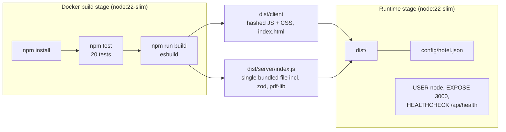
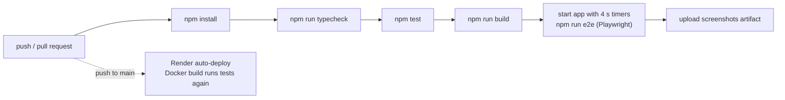

# 4. Deployment and DevOps

**Live demo:** https://white-label-hms.onrender.com
**Related:** [Runbook](12-runbook.md), [Performance and scaling](09-performance-scalability.md)

This document describes how I build, ship and run the app.

## 4.1 Environments

| Environment | Where | Database | Timers | Purpose |
| --- | --- | --- | --- | --- |
| Local dev | `npm run dev` on a laptop | `./data/hms.sqlite` | from `.env` | Development with auto-rebuild and restart |
| Local prod-like | `npm run build && npm start` | `./data/hms.sqlite` | from `.env` | Checking the production bundle |
| CI | GitHub Actions, Ubuntu, Node 22 | `/tmp/e2e.sqlite` | 4 s (fast e2e) | Typecheck, tests, build, browser journey |
| Demo (production) | Render web service, Docker, free plan | `/data/hms.sqlite` inside the container (ephemeral) | from `render.yaml` | Shared with reviewers |

## 4.2 Build and runtime

- The **build stage** fails the image if any test fails, so a broken commit never reaches production.
- The **runtime stage** contains only `dist/` and `config/`; there is no `node_modules` at runtime because esbuild bundles the server's dependencies into one file.
- The container runs as the unprivileged `node` user and writes only to `/data`.
- `PLAYWRIGHT_SKIP_BROWSER_DOWNLOAD=1` keeps the e2e browser out of the image.

The commands I use:

| Command | What it does |
| --- | --- |
| `npm run build` | Client bundle with content-hashed names + `index.html`; server bundle `dist/server/index.js` |
| `npm start` | `node --env-file-if-exists=.env dist/server/index.js` |
| `npm run dev` | esbuild watch for the client + `node --watch` for the server |
| `docker build -t hms . && docker run -p 3000:3000 -v hms-data:/data hms` | Runs the image locally with a persistent volume |

## 4.3 Render setup

I deploy with a Render Blueprint, [`render.yaml`](../render.yaml), which Render reads to create and configure the service.

| Setting | Value |
| --- | --- |
| Type / runtime | Web service, Docker (uses the repo `Dockerfile`) |
| Plan | Free |
| Health check | `GET /api/health` (must return 2xx before traffic switches) |
| Auto-deploy | On every push to `main` |
| Env vars | `NODE_ENV=production`, `AUTO_ADVANCE_SECONDS=10`, `AUTO_ADVANCE_SECONDS_FOOD=10`, `AUTO_ADVANCE_SECONDS_LAUNDRY=10`, `AUTO_ADVANCE_TICK_SECONDS=2`, `EARLY_CHECKIN_DAYS=0` |
| TLS | Managed by Render (`https://white-label-hms.onrender.com`) |

I created the service through Render's Blueprint flow (New → Blueprint → this repository → Apply); since then every push to `main` deploys automatically.

**Free-plan behaviour and how I handle it**

| Behaviour | Effect on the demo | How I handle it |
| --- | --- | --- |
| Sleeps after 15 min without traffic; ~1 min to wake | First visitor waits | I open the link a minute before a demo |
| No persistent disk | Database resets on restart or redeploy (re-seeded automatically) | Acceptable for a demo; real use needs a paid plan with a disk |
| 512 MB RAM, 0.1 CPU | Enough for this app | A larger plan for real load |

The `disk` block in `render.yaml` is commented out because the free plan has no disks. On the Starter plan with that block enabled (mounted at `/data`), data survives restarts.

## 4.4 CI/CD pipeline

My pipeline, [`.github/workflows/ci.yml`](../.github/workflows/ci.yml), runs on every push to `main` and every pull request. The e2e step books, checks in, orders, books spa and transfer, checks out and downloads the invoice in headless Chromium, failing on any browser console error. Screenshots are uploaded as a build artifact for review.

**My release flow:** branch → pull request (CI must pass) → merge to `main` → Render builds and deploys → health check passes → traffic switches to the new version.

## 4.5 Configuration reference

All variables are optional; defaults are in [`src/server/config/env.ts`](../src/server/config/env.ts) and validated at start-up (the process exits with a clear message on a bad value).

| Variable | Default | Purpose |
| --- | --- | --- |
| `NODE_ENV` | `development` | `production` caches `index.html` |
| `PORT` | `3000` | HTTP port |
| `HOST` | `0.0.0.0` | Bind address |
| `DATABASE_PATH` | `./data/hms.sqlite` | SQLite file (`:memory:` for tests) |
| `HOTEL_CONFIG_PATH` | `./config/hotel.json` | White-label config |
| `CLIENT_DIR` | `./dist/client` | Built web client |
| `RESET_DB_ON_START` | `false` | Delete and re-seed the database on boot |
| `AUTO_ADVANCE_ENABLED` | `true` | Simulated staff on/off |
| `AUTO_ADVANCE_TICK_SECONDS` | `2` | Scheduler interval |
| `AUTO_ADVANCE_SECONDS` | `10` | Default seconds per status |
| `AUTO_ADVANCE_SECONDS_FOOD` … `_TRANSFER` | default | Per-service override (FOOD, LAUNDRY, HOUSEKEEPING, AMENITY, MAINTENANCE, SPA, TRANSFER) |
| `HOUSEKEEPING_TURNAROUND_SECONDS` | `300` | Dirty room becomes clean after this |
| `EARLY_CHECKIN_DAYS` | `0` | Online check-in opens N days before arrival |
| `RATE_LIMIT_PER_MINUTE` | `30` | Failed lookups allowed per IP per minute |

Property-specific settings (brand, prices, taxes, catalogue) live in `config/hotel.json`, not in env vars; the [operator guide](14-user-guide.md#143-operator-guide) describes them.

## 4.6 Observability

- **Logs:** one JSON line per API request (`method`, `path`, `status`, `ms`) and per scheduler tick that changed something (`advanced`, `cleaned`); unhandled errors log the stack. Render shows them under the service's Logs.
- **Health:** `GET /api/health` → `{"ok":true,"today":"2026-11-19"}`; used by Render and the Docker `HEALTHCHECK`.
- **Planned for production:** shipping logs to a log service, request IDs, metrics (request rate, latency, scheduler lag) and uptime alerts.

## 4.7 Backup, restore and rollback

| Task | How I do it |
| --- | --- |
| Roll back a bad deploy | Rollback to the previous deploy from Render's deploy history, or `git revert` and a push |
| Back up data (with a disk) | From the Render shell I run `node -e "new (require('node:sqlite').DatabaseSync)('/data/hms.sqlite').exec(\"VACUUM INTO '/data/backup.sqlite'\")"` (a consistent copy while the app runs) and copy the file to object storage |
| Restore | Stop the service, replace `/data/hms.sqlite`, start it again |
| Reset demo data | A restart on the free plan, or one deploy with `RESET_DB_ON_START=true` |

Schema migrations are forward-only and run at boot, so rolling back code after a migration that added tables is safe (old code ignores new tables). I split destructive schema changes into two releases.

## 4.8 Other hosts

The image runs anywhere Docker runs, with a volume at `/data` for the database.

| Host | How it runs there |
| --- | --- |
| Railway | Built from GitHub with the Dockerfile, volume at `/data` |
| Fly.io | `fly launch` with a `data` volume mounted at `/data` |
| Any VM | `docker run -d -p 80:3000 -v /srv/hms:/data --restart unless-stopped hms` behind a TLS proxy |
