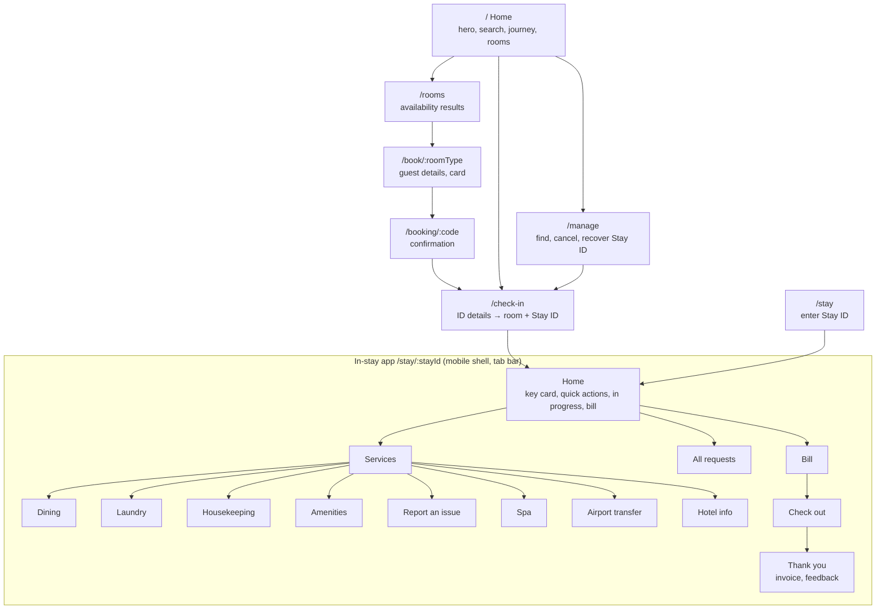
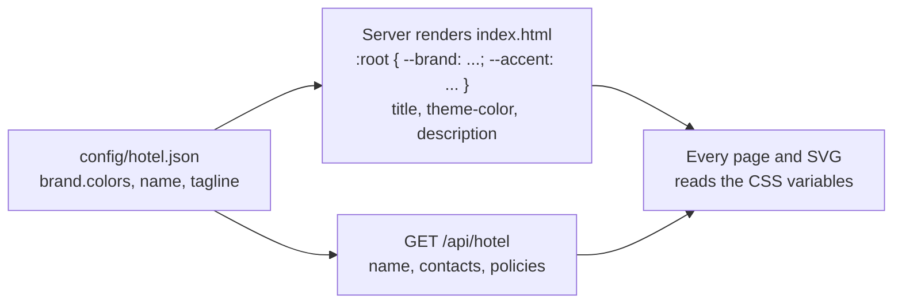

# 7. UI/UX design

**Related:** [User guide](14-user-guide.md), [Requirements](05-requirements.md)

## 7.1 My design goals

1. **One journey, no detours.** Every screen points to the next step of the stay: book → check in → order → check out.
2. **Phone first for the stay.** The in-stay app is built for a 390 px screen held in one hand: big targets, a fixed tab bar, the cart pinned above it.
3. **No account, no friction.** Two memorable credentials (booking reference + last name, then the Stay ID) replace sign-up and passwords.
4. **Always show the money.** Prices before booking, the running bill during the stay, every tax on the invoice.
5. **Re-brandable by config.** Colours, name and illustrations follow the hotel config; nothing in the UI hard-codes the demo brand.

## 7.2 Site map

## 7.3 Screen inventory

| Screen | Main job | Key elements | States handled |
| --- | --- | --- | --- |
| Home | Start a booking or open a stay | Hotel name as headline, date and guest search, 4-step journey, room cards with "from" price | Loading |
| Rooms | Compare and choose | Search bar, one row per room type: illustration, facts, amenities, total, rooms left, Select | Sold out, too small for party, "only N left", invalid dates |
| Book | Capture guest and card | Two fieldsets, nightly price breakdown, terms, total on the button | Validation errors, sold out in the meantime |
| Confirmation | Hand over the reference | Large reference, check-in status, next actions | Opened without session data → link to Manage booking |
| Manage booking | Self-service | Lookup form; booking card with status tag; cancel with inline confirmation; Stay ID recovery | Not found, cancelled, checked in |
| Online check-in | Register and get the room | Lookup + ID fieldsets; result shows the **key card** | Too early, already checked in, ended |
| Stay home | Hub of the stay | Key card (room number, Stay ID, check-out), 6 quick tiles, in-progress requests, current bill, check-out | Nothing in progress (empty state), checked out (redirect) |
| Dining / Laundry | Order with a cart | Section chips, item rows with quantity steppers, pinned cart bar with total | Empty cart, order placed (status card) |
| Housekeeping / Amenities | Free requests | Grouped items with steppers, notes, send button | Nothing selected |
| Report an issue | Get something fixed | Category radio cards, description, urgent | Sent (status card) |
| Spa | Book a slot | Treatment radio cards with price, day chips, slot grid (taken slots struck through), summary and book | No free times that day, slot taken meanwhile |
| Airport transfer | Book a car | Direction chips, airport, day/time, flight, passengers, car radio cards, price on button | Not enough notice, too many passengers |
| Hotel info | Answer common questions | Wi-Fi with copy button, hours, local guide with distances, house rules, contacts | — |
| Bill | Transparency | Balance, every line with date and quantity, subtotal, each tax, refunds in green | Final bill after check-out |
| Check out | Pay and leave | Early-departure and refund notices, total due, itemised toggle, card on file or new card | Already checked out |
| Thank you | Close the loop | Total paid, invoice number, PDF download, 1–5 rating and comment | Feedback already sent |

The [user guide](14-user-guide.md) has screenshots of each screen.

## 7.4 Visual language

| Token | Value (demo brand) | Use |
| --- | --- | --- |
| `--brand` | `#12403f` deep sea teal | Header, hero, primary buttons, key card, progress |
| `--accent` | `#d99a1e` saffron | Main call to action, sun motif, focus ring |
| `--surface` | `#e9f0ee` sea glass | Page background |
| `--ink` | `#1b2221` | Text |
| `--brand-ink` | `#ffffff` | Text on brand colour |
| derived | `color-mix()` of the above | Soft tints, lines, muted text, so a new palette stays harmonious |

- **Type:** one sans-serif family (system stack starting with Avenir Next / Segoe UI) with weight contrast: 800 for headlines and big numbers, 600–700 for labels, 400 for body. Prices and codes use tabular figures.
- **Motif: the Gulf arch.** I gave room illustrations, the hero, the key card and the step markers an arched top (`border-radius: 999px 999px …`). It is the one signature element; I kept everything else quiet.
- **The key card.** The room number is set very large on a brand-coloured arched card with the Stay ID, like a physical key card. It is the first thing a checked-in guest sees.
- **Illustrations:** I drew SVG scenes in code from the brand variables (marina skyline, night skyline, sea with observation wheel and balcony rail, terrace with palm), one per room type, so a re-branded hotel gets matching art without images.
- **Radii:** 14 px panels, 9 px inputs, pills for buttons and chips, arch for imagery.

## 7.5 White-label theming

I inject the colours **server-side** into the page head, so there is no flash of the default theme on load. Changing the brand means editing one JSON block, as described in the [operator guide](14-user-guide.md#143-operator-guide).

## 7.6 Interaction patterns

| Pattern | Where | Why |
| --- | --- | --- |
| Pinned cart bar with total and primary action | Dining, laundry | The total is always visible; one tap to order |
| Quantity steppers (− n +) | All catalogue items | Faster than typing on a phone |
| Progress bar per request, current step animated | Request cards | Status at a glance; animation shows something is happening |
| Radio cards with price on the right | Spa, transfer, maintenance, payment | Large tap targets; price is part of the choice |
| Slot grid with struck-through taken slots | Spa | Shows availability without extra text |
| Inline confirmation instead of a pop-up | Cancel booking | No modal; clear consequence text |
| Explicit notices before irreversible actions | Check-out | Tells the guest about released nights and refunds before paying |
| Polling with no reload | Stay home, requests, bill | Live updates without user action |

## 7.7 Writing style

The rules I followed for all interface text:

- Sentence case everywhere, plain verbs: "Check availability", "Place order", "Pay and check out".
- Buttons say what happens; the same action keeps the same name across the flow.
- Errors explain what to do: "Pick a time between now and your check-out day", "Transfers need at least 2 hours' notice".
- Empty states invite action: "Nothing in progress. Your orders and bookings will show here with live status."

## 7.8 Responsive behaviour and accessibility

| Breakpoint | Behaviour |
| --- | --- |
| ≥ 900 px | Two-column booking and confirmation (form + summary) |
| ≤ 900 px | Booking and confirmation stack into one column |
| ≤ 820 px | Hero illustration hidden; search fields and journey steps in 2 columns |
| ≤ 680 px | Header becomes two rows: hotel name, then the menu as one swipeable line |
| ≤ 520 px | Phone layout for the search form; the in-stay app is always max 520 px wide with a fixed tab bar |
| ≤ 400 px | Dates on their own rows; service tiles in 2 columns; totals shrink to fit |

Checked automatically at 320, 375, 390, 430, 768, 1024, 1366 and 1920 px wide (`npm run e2e:responsive`).

- All inputs have visible labels; groups use `fieldset`/`legend`.
- Visible focus ring (`3px` accent outline) on every interactive element.
- Toggle buttons expose `aria-pressed`; request status regions are `aria-live`; the progress bar has hidden text per step.
- `prefers-reduced-motion` disables the progress animation and transitions.
- Colour is never the only signal: taken slots are also struck through, refunds also have a minus sign.

## 7.9 Known UX gaps

Arabic and right-to-left layout, dark mode, push notifications, saved guest profiles, a QR code for the Stay ID, and a staff-side UI are listed in [Limitations and future scope](13-limitations-future-scope.md).
