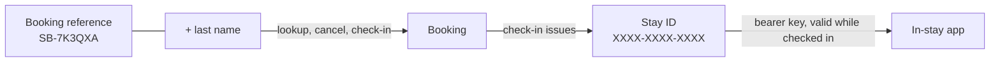

# 8. Security and privacy

**Related:** [LLD 2.7](02-low-level-design.md#27-http-layer-validation-errors-limits), [Decision ADR-03](11-decision-records.md#adr-03-no-login-booking-reference-and-stay-id)

This is a demo, but I built it the way I build a production guest app. This document lists what protects what, and what I still plan to add before production.

## 8.1 Assets and threats

| Asset | Threat | Main controls |
| --- | --- | --- |
| A guest's booking (name, email, phone, dates) | Someone looks it up or cancels it | Needs reference **and** last name; failed lookups rate-limited |
| A guest's stay (room number, orders, bill, Wi-Fi) | Someone guesses a Stay ID and orders on the guest's bill | ~59-bit random Stay ID; failed lookups rate-limited; Stay ID only works while checked in for changes |
| Card data | Theft of card numbers | Full numbers are never stored (brand + last 4 only); no CVC sent to the server |
| ID document data | Theft of passport or Emirates ID numbers | Only the last 4 characters are stored |
| Inventory and bills | Double selling, tampered amounts | Database constraints, append-only ledger, server-side prices and taxes |
| The service | Abuse, oversized requests, crashes | Request budget per IP, 64 KB body cap, Zod validation, generic 500s |
| The browser session | XSS, clickjacking, data leaks via referrer | React escaping, strict CSP, `X-Frame-Options: DENY`, `Referrer-Policy: no-referrer` |

## 8.2 Identity without accounts

| Credential | Strength | Limits |
| --- | --- | --- |
| Booking reference + last name | 31⁶ ≈ 887 million references × the name must match | Two factors the guest already has; same model airlines use for "manage booking" |
| Stay ID | 31¹² ≈ 7.9 × 10¹⁷ (~59 bits) from `crypto.randomInt` | At 30 failed guesses per minute per IP, guessing one active Stay ID among 100 is far beyond practical |

**Brute-force protection:** every 404 on `/reservations/:code`, `/check-in` or `/stays/...` counts as a failed lookup for that IP. After `RATE_LIMIT_PER_MINUTE` (30) failures in a minute, those endpoints return `429` with `Retry-After` until the window ends. A general budget of 300 API calls per minute per IP also applies (`max(10 × limit, 120)`).

**Least privilege by state:** changing anything or reading Wi-Fi details requires a stay that is **currently checked in**. After check-out the Stay ID only reads the bill, invoice and requests.

## 8.3 Personal data

| Data | Collected | Stored | Shown back |
| --- | --- | --- | --- |
| Name, email, phone | Booking | Yes | To whoever has reference + last name |
| Special requests | Booking (optional) | Yes | Not exposed by the API after booking |
| Card number | Booking / check-out | **No**, brand + last 4 only | "Visa ending 4242" |
| Card expiry, CVC | Booking | **No** (CVC never leaves the browser) | — |
| Nationality, ID type | Check-in | Yes | No |
| ID number | Check-in | **Last 4 characters only** | No |
| Arrival time | Check-in (optional) | Yes | No |
| Feedback | After check-out | Yes | No |

**Privacy notes (UAE PDPL / GDPR-style principles)**
- *Data minimisation:* only what a hotel needs to register a guest; card and ID numbers are truncated on arrival.
- *Purpose limitation:* data is used only to run the stay; there is no marketing or tracking, no third-party scripts, no cookies (local storage only keeps the Stay ID on the guest's own device).
- *Retention:* the demo database resets on restart. For production I plan a retention job that anonymises guest details a set number of months after check-out and keeps invoices for the legally required period.
- *Rights:* for production I plan export and erasure of guest details, while keeping tax records.

Guest registration rules (for example, UAE hotels reporting guests to the authorities) need the full document and are handled at the front desk in this design; the app explains that the original document is checked when the key is collected.

## 8.4 Payments

- The MVP **does not take money**. Cards are format-checked (Luhn, `MM/YY`) and then reduced to brand + last 4.
- My production design: card fields served by the payment provider (hosted fields or a payment page), the server receives a token, and charges use 3-D Secure. This keeps the app in the lightest PCI DSS scope (SAQ A), because card numbers never touch the app's servers.

## 8.5 Application security controls

| Control | Implementation |
| --- | --- |
| Input validation | Zod schema on every body and query; lengths, enums, formats, ranges |
| Server-side truth | Prices, taxes, availability and totals are always computed on the server from the database and config, never taken from the client |
| SQL injection | Every query uses bound parameters (`?`); no SQL is built from input |
| XSS | React escapes output; no `dangerouslySetInnerHTML`; brand values injected into `index.html` are HTML-escaped and colours are validated as `#rrggbb` |
| CSP | `default-src 'self'; script-src 'self'; connect-src 'self'; img-src 'self' data:; style-src 'self' 'unsafe-inline'; frame-ancestors 'none'; base-uri 'self'; form-action 'self'` |
| Other headers | `X-Content-Type-Options: nosniff`, `X-Frame-Options: DENY`, `Referrer-Policy: no-referrer`, `Permissions-Policy: camera=(), microphone=(), geolocation=()` |
| Transport | HTTPS terminated by Render |
| Request limits | JSON only, 64 KB max, `415`/`413` otherwise |
| Path traversal | Static paths are normalised and must stay inside the client directory |
| Error handling | Known errors return a code and message; unknown errors return a generic 500 and are logged with the stack server-side |
| Concurrency | Write transactions (`BEGIN IMMEDIATE`) and compare-and-set updates prevent race conditions on rooms, spa slots, status changes and check-out |
| Container | Runs as non-root `node` user; only `/data` is writable; no build tools or dev dependencies at runtime |
| Secrets | None are needed in the MVP; production secrets (payment keys) will live in the host's secret store, never in the repo |

## 8.6 Known gaps before production

| Gap | Risk | My planned fix |
| --- | --- | --- |
| No staff authentication (no staff UI yet) | — | SSO/OIDC with roles when the staff console is added |
| Stay ID in the URL | Visible in browser history and in screenshots | Exchange it for an HttpOnly session cookie after first open; rotate on check-out |
| In-memory rate limiter | Resets on restart; per instance | Shared store (Redis) at the edge or in the app |
| No audit log for guest-side actions beyond request events | Harder investigations | Central audit log with actor, IP, action |
| No CSRF token | Low: JSON-only API, no cookies, same-origin CSP | Required once cookies are used |
| Dependency scanning | Vulnerable packages | Dependabot or `npm audit` in CI |
| `style-src 'unsafe-inline'` | Small CSP relaxation for React inline styles and the injected theme | Nonce-based styles |
