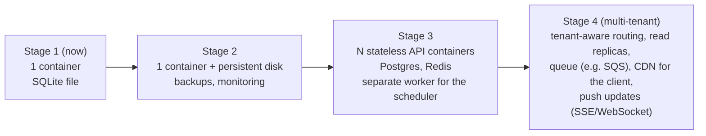

# 9. Performance and scalability

**Related:** [HLD](01-high-level-design.md), [Database 3.8](03-database-design.md#38-path-to-postgresql-and-multi-tenancy), [Deployment](04-deployment-devops.md)

## 9.1 Targets for the MVP

| Metric | Target | Notes |
| --- | --- | --- |
| API latency | p95 < 200 ms for a single hotel | Local runs log 1–3 ms per request; SQLite queries are indexed |
| Status freshness | A status change visible within 6 s of becoming due | Scheduler checks every 2 s, the app polls every 4 s (1 s ticks in CI) |
| First load | < 300 KB transferred (gzip) | One JS bundle (~270 KB raw), one CSS file (~19 KB raw), no web fonts or images |
| Capacity | One hotel (17 rooms in the demo; hundreds is fine) | Single process, single SQLite file |
| Cold start (Render free) | ~1 min after 15 min idle | Platform behaviour, not the app |

## 9.2 What makes it fast today

- **Everything in one process:** no network hop between API and database; SQLite runs in-process.
- **Indexes on every lookup path:** booking reference, Stay ID, requests and folio by reservation, a partial index for due requests, primary-key probes for room-nights and spa slots.
- **Small payloads:** list endpoints return only what the screen shows; money as integers.
- **Static assets:** content-hashed file names served with `Cache-Control: immutable` for a year; `index.html` is cached in memory in production.
- **Polling pauses** when the browser tab is hidden.
- **The scheduler** scans only the partial index (`next_transition_at IS NOT NULL`) and caps each tick at 500 requests.

## 9.3 Current limits

| Limit | Why | When it matters |
| --- | --- | --- |
| One instance | SQLite file + in-process scheduler + in-memory rate limiter | High availability or more than one server |
| One writer at a time | SQLite serialises writes | Hundreds of writes per second (far beyond one hotel) |
| Polling | Each open in-stay app makes ~15 requests per minute | Thousands of concurrent guests |
| Synchronous PDF rendering | Rendered per download | Bulk invoice exports |
| Ephemeral disk on the free plan | Data lost on restart | Any real use |

Rough sizing: a 200-room hotel with every guest's app open generates about 200 × 15 = 3,000 lightweight reads per minute (50/s). SQLite and Node handle this on one small instance.

## 9.4 Scaling path

| Concern | Change at stage 3–4 |
| --- | --- |
| Database | PostgreSQL with connection pooling; exclusion constraint for bookings; read replicas for reports |
| Scheduler | Separate worker process; claims due rows with `FOR UPDATE SKIP LOCKED`, or a job queue with delayed jobs |
| Live updates | Server-Sent Events or WebSockets fed by Postgres `LISTEN/NOTIFY` or a pub/sub, replacing polling |
| Rate limiting | Shared counters in Redis or at the CDN/WAF |
| Static client | Served from a CDN; API on its own domain or path |
| PDFs | Rendered once at check-out and stored in object storage |
| Multi-tenancy | `tenant_id` and `property_id` on every row, row-level security, per-tenant config in the database instead of a file |

## 9.5 How to measure

- Request timings are already in the logs (`"ms": 2`).
- A load test with k6 or autocannon against `/api/availability` and `/api/stays/:id/requests` would set the baseline before any infrastructure change.
- Production would add metrics for p50/p95 latency per endpoint, scheduler lag (now − oldest due `next_transition_at`) and error rate.
