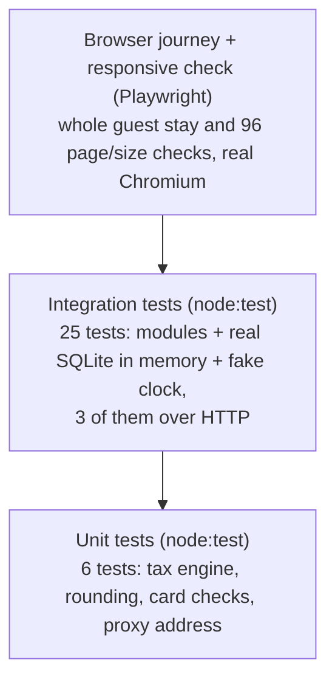

# 10. Testing strategy and test report

**Related:** [Requirements](05-requirements.md), [Deployment 4.4](04-deployment-devops.md#44-cicd-pipeline)

## 10.1 Strategy

I test at six levels: unit, integration (including HTTP tests against a real server on a random port), end to end, responsive, live smoke test and type checking. The first four are automated:

| Level | Tool | What it proves | Runs |
| --- | --- | --- | --- |
| Unit | `node:test` + `assert` | Pure rules: taxes, rounding, Luhn, card expiry, client address from `X-Forwarded-For` | `npm test`, CI, Docker build |
| Integration | `node:test` + in-memory SQLite + `FixedClock` | Business rules end to end through the modules and the real schema, constraints and triggers; HTTP behaviour (malformed addresses, content type, lookup limits) through `createHttpServer` on a random port | `npm test`, CI, Docker build |
| End to end | Playwright (`tests/e2e/journey.mjs`) | The built app works in a browser: every screen, no console errors, PDF downloads | `npm run e2e`, CI |
| Responsive | Playwright (`tests/e2e/responsive.mjs`) | 12 pages × 8 screen sizes (320 px to 1920 px): no sideways scrolling, no controls under 32 px tall | `npm run e2e:responsive`, CI |
| Live smoke test | Manual walkthrough in Chrome against the deployed site | Production build and hosting behave like local | After deploys |
| Type checking | `tsc --noEmit` (strict) | API types shared by client and server stay in sync | `npm run typecheck`, CI |

**Why integration tests carry the weight:** most rules worth testing (no double booking, append-only ledger, slot capacity) live partly in the database. I run them against a real in-memory SQLite with the real migrations, so they test the constraints themselves, not a mock. The injected clock makes time-based rules (check-in windows, timers, slot lead times) deterministic and instant.

## 10.2 Test catalogue

| # | Test | Covers |
| --- | --- | --- |
| 1 | availability drops as rooms are sold and the type sells out, never overbooks | US-01, US-02; overlap by one night refused, back-to-back stays allowed |
| 2 | the database itself rejects a second sale of the same room-night | `room_nights` primary key |
| 3 | weekend nights are priced with the configured uplift | Thu/Fri × 1.2 |
| 4 | input rules: no past dates, party must fit, card must be valid | 400 / 422 paths |
| 5 | lookup needs the matching last name; cancelling frees the room | US-03, case-insensitive match, inventory release, double cancel refused |
| 6 | check-in issues a Stay ID and posts one room charge per night | US-04, Stay ID format, idempotency, only last 4 ID characters stored |
| 7 | online check-in opens on arrival day, or earlier with EARLY_CHECKIN_DAYS | Check-in window, env override |
| 8 | orders post to the folio; laundry express adds its surcharge; free services cost nothing | US-05–07, merged lines, wrong-service item refused |
| 9 | auto-advance follows AUTO_ADVANCE_SECONDS_\<SERVICE\> and records each status | Per-service timers, terminal state, event history |
| 10 | a request can be cancelled only before work starts, and its charge is reversed | US-12, negative adjustments |
| 11 | folio entries are append-only at the database level | Triggers block UPDATE/DELETE |
| 12 | spa: three treatment rooms per slot, lead time enforced, completes after its slot | US-09, capacity, 60-min notice, closing time, completion at slot end |
| 13 | transfers need notice and a car big enough | US-10, 2-h notice, seats, arrival time |
| 14 | early check-out releases unused nights, refunds future spa, freezes an invoice | US-14, min one night, tourism fee per night, frozen bill, PDF, feedback once |
| 15 | early check-out cancels transfers booked for a later day but keeps today's | US-14 refund rule |
| 16 | rooms left dirty at check-out are cleaned after HOUSEKEEPING_TURNAROUND_SECONDS | Turnaround timer |
| 17 | UAE-style stack: VAT is charged on the net amount plus service charge and municipality fee | Tax engine compounding |
| 18 | adjustments reduce the tax basis and empty bases produce no tax line | Refunds and taxes |
| 19 | rounding happens once per tax, half away from zero | Money rounding |
| 20 | card numbers are Luhn-checked | Card validation |
| 21 | a malformed address gets a 400 and the server keeps answering | `/api/stays/%E0%A4%A` → 400, health still 200, `text/plain` body → 415 |
| 22 | client address is read from the right of X-Forwarded-For, as many hops as trusted | Spoofed entries ignored, `TRUST_PROXY_HOPS` 0/1/2, default 2 on Render |
| 23 | only failed lookups count toward the lookup block, and known Stay IDs keep working | 3 unknown IDs → 4th answers 429; the guest's own Stay ID still 200 |
| 24 | per-item quantity is capped after duplicate lines are merged | 15 + 10 refused, 10 + 10 accepted |
| 25 | body rules: real numbers, real clock times, no expired cards, blank optional fields ignored | `"2"` refused for a number, `25:00` refused, expired card refused, `""` arrival time ignored |
| 26 | after check-out time on the last day, new requests stop but check-out still works | 11:59 open, 12:00 `409 stay_ended`, `overdue` flag, check-out succeeds |
| 27 | invoice numbers come from a per-year counter | 2026-00001, 2026-00002, then 2027-00001 |
| 28 | percentages are computed in whole numbers, so decimal rates round correctly | 4.35% of AED 30.00 = 1.31 |
| 29 | the check-out preview matches check-out exactly and changes nothing | No folio rows, no status change, no invoice number used; preview amount = invoice total |
| 30 | early check-out shortens the reservation to the nights charged | `check_out`, room total, nights; Stay ID still returned after check-out |
| 31 | check-out day: spa must finish by check-out time, arrivals pick-ups are refused, departures allowed | Spa slots end by 12:00; `from_airport` refused, `to_airport` booked |

### Browser journey steps (`npm run e2e`)

Desktop 1280 px: home → availability → select Sea View Premier → fill guest and test card → confirm → check in online.
Phone 390 px: stay home → dining cart (2 × Shakshuka, 1 × Karak chai) → order → home shows the order in progress → spa slot on tomorrow's date (always free, whatever time the run starts) → express laundry → airport transfer → home shows Upcoming → maintenance report → hotel info → bill → all requests → check out → rate 5 → download PDF → send feedback.
The run fails on any browser console error. Screenshots are saved to `test-results/screenshots/`.

## 10.3 Results

### Automated (19 November 2026)

| Suite | Result |
| --- | --- |
| `npm test` | **31 / 31 passed** (~1.5 s) |
| Server, test and client type checking | Passed |
| Browser journey against the production build | **Passed**, 0 console errors, PDF valid |
| Responsive check, 96 page/size combinations | **Passed** after fixing 5 overflows on 320–375 px phones (search form, service tiles, bill and check-out totals) and the phone header |

### Live site (https://white-label-hms.onrender.com, 19 November 2026)

| Check | Result |
| --- | --- |
| Home and room search render; 4 room types with correct availability and prices | Pass |
| API errors: past dates 400, unknown booking 404, unknown Stay ID 404 | Pass |
| Security headers present (CSP, `X-Frame-Options: DENY`) | Pass |
| Booking SB-QRGBUU (Deluxe King, 2 nights, AED 1,560) | Pass |
| Online check-in → room 101 + Stay ID | Pass |
| Dining order through the cart (AED 114) | Pass |
| Laundry express, towels, pillows, maintenance, spa slot, airport transfer | Pass (all 201) |
| Transfer with 5 passengers in a 3-seat sedan refused | Pass (400) |
| Auto-progress after ~1 min; laundry still waiting on its 90 s timer (timers at that time: 45 s default, 60 s food, 90 s laundry; all now 10 s) | Pass |
| Bill AED 2,883.46; each tax checked by hand | Pass |
| Early check-out: night and future spa released; total AED 1,390.48; room back on sale | Pass |
| PDF invoice (`%PDF-`, `application/pdf`), feedback, no console errors | Pass |

**Defects I found and fixed during live testing**

| Defect | Fix |
| --- | --- |
| Confirmation said "we have sent the details to your email", but no email is sent | Copy changed to confirm the booking only |
| Check-out said "Card used to book" without saying which card | Shows "Visa ending 4242" |
| Early check-out kept an airport transfer booked for a later day | Later-day transfers are cancelled and refunded; same-day kept (test 15) |

### Live retest after the keep-awake fix (19 November 2026)

I repeated every feature on the live site with booking SB-CC9FJ4, using the 10-second timers.

| Check | Result |
| --- | --- |
| Health page shows every service timer at 10 s, scheduler every 2 s | Pass |
| Room search, booking, confirmation text, Manage booking (wrong last name refused, correct one case-insensitive) | Pass |
| Online check-in with an Emirates ID → room 201 and a Stay ID | Pass |
| Dining cart with the Mains filter and the − button (AED 160) | Pass |
| Express laundry (AED 165 incl. 50%), cancelled before pickup and refunded | Pass |
| Housekeeping with a note, amenities, maintenance (category required, urgent flag) | Pass |
| Spa: 3 overlapping 90-min bookings accepted, a 4th refused; last start 20:30 | Pass |
| Transfers: under 2 h notice refused; 5 passengers in a sedan flagged; same-day DXB and later-day DWC booked | Pass |
| Statuses: dining, housekeeping, amenities and maintenance completed within about a minute | Pass |
| **Site idle for 17 minutes, then the stay reopened** (page loaded in 0.3 s, no cold start) | Pass |
| Bill AED 5,684.04, every tax checked by hand | Pass |
| Early check-out: second night, 3 future spa bookings and the later-day transfer refunded; same-day transfer kept; total AED 1,819.95 | Pass |
| PDF invoice, feedback once, Wi-Fi and new orders refused after check-out (409), no console errors | Pass |

**Defects I found and fixed in the retest**

| Defect | Fix |
| --- | --- |
| A stay disappeared after about 15 minutes without visitors: Render stopped the idle free service and the restart cleared the database | The app pings its own `/api/health` every 10 minutes so the service never idles |
| After cancelling from an order's confirmation screen, the card still showed the old status and a Cancel button | The card updates from the cancel response straight away |
| Future spa and transfer bookings sat under "In progress" until their booked time, which looked like a stuck timer | They are listed under a separate **Upcoming** section with a static progress bar |
| House rules mentioned asking "in the app" for a late check-out, which the app does not offer | The rule now refers to reception |

### Live retest after the review fixes (19 November 2026)

I repeated every scenario in Chrome on the live site with booking SB-2885YS (Deluxe King, 3 nights, checked out after the first).

| Check | Result |
| --- | --- |
| New version live: HSTS and CSP headers, `415` for `text/plain` and `application/jsonx`, `HEAD` and trailing slash answered, no source map served | Pass |
| Malformed addresses (`%FF`, `%E0%A4`) answer `400` and the service keeps running | Pass |
| Clearing the check-in date leaves the search form working; picking a later check-in moves check-out | Pass |
| A booking link for Deluxe King with 4 adults shows "does not fit" instead of the form | Pass |
| Booking button "Confirm booking, AED 2,210.00 before taxes"; booking confirmed | Pass |
| Confirmation before check-in opens: button disabled, opening date shown | Pass |
| Manage booking: wrong last name refused, `KHAN` and `khan` accepted | Pass |
| Arrival time `25:00` refused by the API; check-in with no arrival time and a lower-case name → room 101 and a Stay ID | Pass |
| Unknown Stay ID message; `/stay/` reopens the remembered stay | Pass |
| API refuses 15 + 10 of one item, `"2"` as a quantity, `9:5` as a pickup time, a laundry item on the food menu and an unknown issue category | Pass |
| Dining (AED 114): the card after ordering moved to "Kitchen is preparing" by itself; one live region announced it; Services tab highlighted | Pass |
| Laundry pickup times offered from 12:00 at 11:01; express laundry (AED 60) cancelled and stayed cancelled through later polls | Pass |
| Housekeeping, amenities and an urgent air-conditioning report placed and completed | Pass |
| Spa: today's slots start 60 minutes ahead; on the check-out day only 10:00–11:00 starts are offered and 11:30 is refused by the API; cancel asks "Cancel this booking?" and **Keep it** keeps the booking | Pass |
| Transfers: 5 passengers in a sedan disables the button; an airport pick-up on the check-out day and a pick-up 90 minutes ahead are refused; drop-offs today and on the check-out day booked; a pick-up on Fri 20 cancelled through **Yes, cancel** | Pass |
| Home lists the spa treatment and both drop-offs under Upcoming, with "Nothing in progress right now. Your upcoming bookings are listed below." | Pass |
| Bill AED 3,835.58, every tax checked by hand | Pass |
| Check-out page: 2 unused nights from Fri 20 Nov, the spa treatment and the later drop-off listed; "Pay AED 1,321.18 and check out"; calling the preview twice changed nothing | Pass |
| Check-out charged exactly AED 1,321.18; invoice SB-INV-2026-00001; PDF downloads; today's drop-off kept, later bookings cancelled | Pass |
| Booking shortened to 19–20 Nov, 1 night, AED 780; Deluxe King back to 6 free rooms for 20–22 Nov | Pass |
| After check-out: orders, Wi-Fi, preview and a second check-out answer `409 stay_closed`; feedback once, then `409 feedback_exists` | Pass |
| Manage booking after check-out shows **View invoice** | Pass |
| No browser console errors | Pass |

**Defects I found and fixed in this retest**

| Defect | Fix |
| --- | --- |
| 31 lookups of unknown Stay IDs in a minute were never blocked on Render: its `X-Forwarded-For` ends with a Cloudflare address that changes between requests, so every request counted under a different key | On Render (`RENDER=true`) the app trusts two hops and reads the address Cloudflare saw; `TRUST_PROXY_HOPS` still overrides it (test 22) |
| Focus went to the page container instead of the heading on pages that load data first | Focus waits up to 3 seconds for the heading |
| Dates in messages read "Sun, 22 Nov 2026" | "Sun 22 Nov 2026" |
| **View invoice** and **Look up another booking** touched each other on Manage booking | Placed in a spaced row |

One malformed address, `%E0%A4%A`, is answered by Render's edge with `520` before it reaches the app; similar addresses reach the app and get its `400`.

### Full project review (19 November 2026)

Before handing the project over I had the whole repository reviewed in parallel: server, client, data and billing, security, build and CI, and the documents. The review only reported; I decided on each finding. These are the findings I fixed, all covered by the tests above or by the browser runs.

| Area | Finding | Fix |
| --- | --- | --- |
| HTTP | A malformed percent-encoded address (`/api/stays/%E0%A4%A`) threw outside the error handler | Decoding is guarded and answers `400`; the whole request callback is wrapped (test 21) |
| HTTP | The client address was the left-most `X-Forwarded-For` entry, which a client can set itself | Address taken `TRUST_PROXY_HOPS` from the right (test 22) |
| HTTP | Every 404 counted as a failed lookup, and one guest's mistakes could block others on the same Wi-Fi | Only unknown booking references and Stay IDs count; codes that resolved recently keep working; the general budget is per Stay ID (test 23) |
| HTTP | The rate limiter's memory grew with every new key | At most 50 000 keys, expired and then oldest dropped |
| HTTP | `application/jsonx` passed the content-type check; `'` was not escaped in the injected brand text; no HSTS | Exact `application/json` match; `'` escaped; HSTS in production |
| HTTP | Booking references and Stay IDs appeared in logs | Logged as `:code` |
| Validation | Strings such as `"2"` were accepted for numbers; `99:99` passed as a time; expired cards were accepted; `""` failed optional fields | JSON numbers only, strict `HH:mm`, expiry this month or later, blank strings treated as absent (test 25) |
| Ordering | 15 + 10 of the same item passed the 20-per-item limit once merged | Limit applied after merging (test 24) |
| Stay end | Guests could keep ordering after check-out time on the last day | `409 stay_ended` after check-out time, an `overdue` flag and an in-app notice; check-out still open (test 26) |
| Stay end | A spa treatment could run past check-out time on the last day; an airport pick-up could be booked for the departure day | Last-day treatments end by check-out time; pick-ups only before the check-out day (test 31) |
| Billing | The check-out page estimated the total in the browser, which could differ from the amount charged | A server preview runs the check-out and rolls it back; the button shows the exact amount (test 29) |
| Billing | Invoice numbers came from counting invoices, which repeats across years and under races | Per-year counter table, migration 2 (test 27) |
| Billing | Percentages were computed in floating point, so 4.35% of AED 30.00 rounded down | Integer maths in hundredths of a percent; rates limited to two decimals (test 28) |
| Billing | After an early check-out the booking still showed the original dates and room total | The reservation is shortened to the nights charged (test 30) |
| Workflow | The scheduler's update did not exclude cancelled requests; check-in did not check that its update changed a row | Both conditions added |
| Client | Clearing a date field crashed the search form; an unexpected error left a blank page | Empty dates handled; top-level error boundary |
| Client | A lost connection replaced the in-stay app with an error page; old data could show for a new address; polls could stack and a slow poll could undo a cancel | Last data kept under a notice; data tied to its address; one request at a time; only the newest response kept |
| Client | The card shown after ordering did not update; spa and transfer cancels had no confirmation | Live card after ordering; a second confirmation for spa and transfer cancels |
| Client | The check-in button on the confirmation page looked active before check-in opened; "Your stay starts today" showed for any open check-in | Disabled button before the window; message depends on the arrival date |
| Client | Sold-out or too-small rooms could be booked from a direct link; a transfer with too many passengers could be submitted; past laundry pickup times were offered | All three blocked in the form |
| Client | `/stay/` opened an empty stay; the Services tab was not highlighted on service pages; "Nothing in progress" showed above upcoming bookings | Stay ID form; tab highlighted; copy points to Upcoming |
| Accessibility | Every request card was a live region; muted text was 4.6:1 on white and 4.0:1 on the page background; focus stayed on the old link after navigation | One live region; `aria-current="step"`; muted text darker (6.4:1 and 5.5:1); focus moves to the heading |
| Build | Production client shipped source maps; the e2e spa step depended on the time of day; CI had no time limit or image build | No client source maps; tomorrow's spa slot; 15-minute limits, `wait-on` timeout, a Docker build job |
| Build | `npm run dev` used a Node flag newer than 22.13; `npm ci` was not used when a lockfile exists | `.env` passed only when present; `npm ci` with a lockfile, `npm install` without |

Findings I decided not to change in the MVP are listed as limitations L17 to L20 in [section 13](13-limitations-future-scope.md).

## 10.4 Tests I plan to add

- Front-end component tests (React Testing Library) for the cart, slot grid and forms.
- API contract tests generated from the shared types (or an OpenAPI file).
- A concurrency test with two bookings racing for the last room from separate processes.
- Load test (k6) for availability and polling endpoints.
- Accessibility checks (axe) in the browser journey.
- Visual regression on the key screens.
