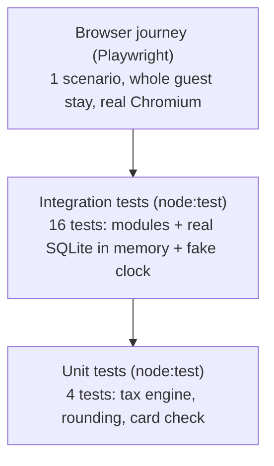

# 10. Testing strategy and test report

**Related:** [Requirements](05-requirements.md), [Deployment 4.4](04-deployment-devops.md#44-cicd-pipeline)

## 10.1 Strategy

| Level | Tool | What it proves | Runs |
| --- | --- | --- | --- |
| Unit | `node:test` + `assert` | Pure rules: taxes, rounding, Luhn | `npm test`, CI, Docker build |
| Integration | `node:test` + in-memory SQLite + `FixedClock` | Business rules end to end through the modules and the real schema, constraints and triggers | `npm test`, CI, Docker build |
| End to end | Playwright (`tests/e2e/journey.mjs`) | The built app works in a browser: every screen, no console errors, PDF downloads | `npm run e2e`, CI |
| Responsive | Playwright (`tests/e2e/responsive.mjs`) | 12 pages × 8 screen sizes (320 px to 1920 px): no sideways scrolling, no controls under 32 px tall | `npm run e2e:responsive`, CI |
| Live smoke test | Claude in Chrome against the deployed site | Production build and hosting behave like local | Manual, after deploys |
| Type checking | `tsc --noEmit` (strict) | API types shared by client and server stay in sync | `npm run typecheck`, CI |

**Why integration tests carry the weight:** most rules worth testing (no double booking, append-only ledger, slot capacity) live partly in the database. Running against a real in-memory SQLite with the real migrations tests the constraints themselves, not a mock. The injected clock makes time-based rules (check-in windows, timers, slot lead times) deterministic and instant.

## 10.2 Test catalogue

| # | Test | Covers |
| --- | --- | --- |
| 1 | availability drops as rooms are sold and the type sells out, never overbooks | US-01, US-02; overlap by one night refused, back-to-back stays allowed |
| 2 | the database itself rejects a second sale of the same room-night | `room_nights` primary key |
| 3 | weekend nights are priced with the configured uplift | Thu/Fri × 1.2 |
| 4 | input rules: no past dates, party must fit, card must be valid | 400 / 422 paths |
| 5 | lookup needs the matching last name; cancelling frees the room | US-03, case-insensitive match, inventory release, double cancel refused |
| 6 | check-in issues a Stay ID and posts one room charge per night | US-04, Stay ID format, idempotency, only last 4 ID characters stored |
| 7 | online check-in opens on arrival day, or earlier with EARLY_CHECKIN_DAYS | Check-in window, env override |
| 8 | orders post to the folio; laundry express adds its surcharge; free services cost nothing | US-05–07, merged lines, wrong-service item refused |
| 9 | auto-advance follows AUTO_ADVANCE_SECONDS_\<SERVICE\> and records each status | Per-service timers, terminal state, event history |
| 10 | a request can be cancelled only before work starts, and its charge is reversed | US-12, negative adjustments |
| 11 | folio entries are append-only at the database level | Triggers block UPDATE/DELETE |
| 12 | spa: three treatment rooms per slot, lead time enforced, completes after its slot | US-09, capacity, 60-min notice, closing time, completion at slot end |
| 13 | transfers need notice and a car big enough | US-10, 2-h notice, seats, arrival time |
| 14 | early check-out releases unused nights, refunds future spa, freezes an invoice | US-14, min one night, tourism fee per night, frozen bill, PDF, feedback once |
| 15 | early check-out cancels transfers booked for a later day but keeps today's | US-14 refund rule |
| 16 | rooms left dirty at check-out are cleaned after HOUSEKEEPING_TURNAROUND_SECONDS | Turnaround timer |
| 17 | UAE-style stack: VAT is charged on the net amount plus service charge and municipality fee | Tax engine compounding |
| 18 | adjustments reduce the tax basis and empty bases produce no tax line | Refunds and taxes |
| 19 | rounding happens once per tax, half away from zero | Money rounding |
| 20 | card numbers are Luhn-checked | Card validation |

### Browser journey steps (`npm run e2e`)

Desktop 1280 px: home → availability → select Sea View Premier → fill guest and test card → confirm → check in online.
Phone 390 px: stay home → dining cart (2 × Shakshuka, 1 × Karak chai) → order → home shows the order in progress → spa slot → express laundry → airport transfer → maintenance report → hotel info → bill → all requests → check out → rate 5 → download PDF → send feedback.
The run fails on any browser console error. Screenshots are saved to `test-results/screenshots/`.

## 10.3 Results

### Automated (19 November 2026)

| Suite | Result |
| --- | --- |
| `npm test` | **20 / 20 passed** (~1 s) |
| Server and test type checking | Passed |
| Browser journey against the production build | **Passed**, 0 console errors, PDF valid |
| Responsive check, 96 page/size combinations | **Passed** after fixing 5 overflows on 320–375 px phones (search form, service tiles, bill and check-out totals) and the phone header |

### Live site (https://white-label-hms.onrender.com, 19 November 2026)

| Check | Result |
| --- | --- |
| Home and room search render; 4 room types with correct availability and prices | Pass |
| API errors: past dates 400, unknown booking 404, unknown Stay ID 404 | Pass |
| Security headers present (CSP, `X-Frame-Options: DENY`) | Pass |
| Booking SB-QRGBUU (Deluxe King, 2 nights, AED 1,560) | Pass |
| Online check-in → room 101 + Stay ID | Pass |
| Dining order through the cart (AED 114) | Pass |
| Laundry express, towels, pillows, maintenance, spa slot, airport transfer | Pass (all 201) |
| Transfer with 5 passengers in a 3-seat sedan refused | Pass (400) |
| Auto-progress after ~1 min; laundry still waiting on its 90 s timer | Pass |
| Bill AED 2,883.46; each tax checked by hand | Pass |
| Early check-out: night and future spa released; total AED 1,390.48; room back on sale | Pass |
| PDF invoice (`%PDF-`, `application/pdf`), feedback, no console errors | Pass |

**Defects found and fixed during live testing**

| Defect | Fix |
| --- | --- |
| Confirmation said "we have sent the details to your email", but no email is sent | Copy changed to confirm the booking only |
| Check-out said "Card used to book" without saying which card | Shows "Visa ending 4242" |
| Early check-out kept an airport transfer booked for a later day | Later-day transfers are cancelled and refunded; same-day kept (test 15) |

## 10.4 Gaps and next tests

- Front-end component tests (React Testing Library) for the cart, slot grid and forms.
- API contract tests generated from the shared types (or an OpenAPI file).
- Concurrency test: two bookings racing for the last room from separate processes.
- Load test (k6) for availability and polling endpoints.
- Accessibility checks (axe) in the browser journey.
- Visual regression on the key screens.
