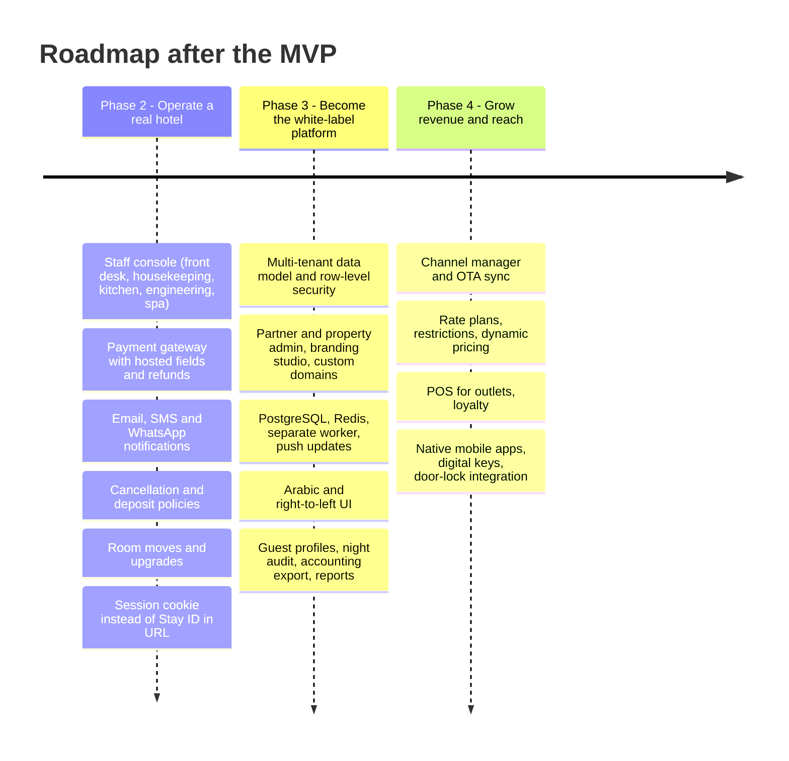

# 13. Limitations and future scope

**Related:** [Requirements](05-requirements.md), [Performance and scaling](09-performance-scalability.md), [Security gaps](08-security-privacy.md#86-known-gaps-before-production)

## 13.1 Current limitations

| # | Limitation | Impact | Acceptable for the demo because… | Fixed in |
| --- | --- | --- | --- | --- |
| L1 | **One hotel only**; no tenants or properties in the data model | Can't run a group or a reseller yet | Shows the full guest journey; white-label is proven by the config file | Phase 3 |
| L2 | **No staff or admin console**; statuses move on a timer | Nobody actually fulfils requests; no front desk, housekeeping board or kitchen queue | The timer shows the full status lifecycle; durations are configurable | Phase 2 |
| L3 | **Mock payments**: card format checked, no charge | No real money, no refunds to a card, no 3-D Secure | Card handling already keeps only last 4 digits; flow and ledger are real | Phase 2 |
| L4 | **No notifications** (email, SMS, WhatsApp) | Guests must keep their reference and Stay ID themselves | References are short and recoverable via Manage booking | Phase 2 |
| L5 | **English only**, left-to-right | Not ready for Arabic-speaking guests | Layout uses logical structure; strings are in components | Phase 3 |
| L6 | **SQLite, single instance**; in-memory rate limiter; scheduler in the web process | No high availability or horizontal scaling | One hotel's load is tiny ([section 9](09-performance-scalability.md)) | Phase 3 |
| L7 | **Data resets** on the free Render plan | Bookings vanish after restarts or redeploys | Clean slate for every reviewer | Paid plan + disk (any time) |
| L8 | **Polling** for live status | Extra requests while the app is open | Simple and reliable at this scale | Phase 3 |
| L9 | **Stay ID in the URL** as a bearer key | Visible in history and screenshots | 59-bit random, rate-limited, only valid while checked in | Phase 2 |
| L10 | **Room assigned at booking**; no room moves, upgrades or out-of-order management UI | Front desk can't reorganise rooms | Guarantees exact inventory per night | Phase 2 |
| L11 | **Single rate per room type** + weekend uplift; no rate plans, promotions or restrictions | No revenue management | Pricing engine is isolated in `priceStay()` | Phase 4 |
| L12 | **No channel manager** or OTA sync | Only direct bookings | Inventory model (`room_nights`) is what an OTA sync would update | Phase 4 |
| L13 | **No night audit or accounting export** | Revenue must be read from invoices | Append-only ledger is the right base for it | Phase 3 |
| L14 | **No guest profiles or history** | Returning guests start fresh | No login by design | Phase 3 |
| L15 | **Free cancellation always**; no deposit or no-show rules | No protection against no-shows | Policies are config-ready | Phase 2 |
| L16 | **Government guest reporting** (e.g. local police/tourism registers) not automated | Front desk must register guests from the ID | Only the last 4 ID characters are stored on purpose | Phase 3 |

## 13.2 Future scope by phase

### Phase 2: operate a real hotel

| Item | Description | Depends on | Effort |
| --- | --- | --- | --- |
| Staff console | Role-based screens: arrivals/departures, request queues per department with "start" and "done" buttons replacing the timer, housekeeping board, maintenance tickets | Staff auth (SSO/OIDC), roles | L |
| Payment gateway | Hosted card fields, tokens, 3-D Secure, pre-authorisation at booking, capture at check-out, refunds | Provider account (e.g. Stripe, Checkout.com, a regional gateway) | M |
| Notifications | Booking confirmation, check-in reminder with link, order updates, invoice email; templates per brand | Email/SMS/WhatsApp provider | M |
| Policies | Deposits, cancellation deadlines and fees, no-show charges | Payments | S |
| Room management | Room moves, upgrades, out-of-order, early check-in rules | Staff console | M |
| Session hardening | Stay ID exchanged for an HttpOnly cookie; QR code for the Stay ID | — | S |

### Phase 3: the white-label platform

| Item | Description | Depends on | Effort |
| --- | --- | --- | --- |
| Multi-tenancy | Partner → property → rooms hierarchy; `tenant_id`/`property_id` everywhere; row-level security | PostgreSQL | L |
| Partner and property admin | Onboarding, plans and modules, branding studio, custom domains with TLS, config moved from file to database | Multi-tenancy | L |
| Infrastructure | PostgreSQL, Redis (rate limits, cache), worker process for the scheduler, SSE/WebSocket updates, CDN | — | M |
| Localisation | Arabic and RTL, translations per tenant, currency and locale per property | — | M |
| Finance | Night audit, city ledger, accounting export (QuickBooks, Xero, Zoho), e-invoicing | Ledger (exists) | L |
| Guest CRM | Profiles, stay history, preferences, consent, data export and erasure | Notifications | M |
| Reports | Occupancy, ADR, RevPAR, revenue by department, service response times | Postgres | M |

### Phase 4: revenue and reach

| Item | Description | Effort |
| --- | --- | --- |
| Channel manager | Two-way availability, rate and restriction sync with Booking.com, Expedia and others, first through a third-party channel manager | L |
| Revenue management | Rate plans (BAR, corporate, packages), restrictions (min stay, closed to arrival), dynamic pricing | L |
| POS and loyalty | Outlet POS posting to the folio; points and member rates | L |
| Mobile and devices | Branded native apps, digital room keys, door-lock vendors (ASSA ABLOY, dormakaba, Salto) | L |

Effort: S ≈ days, M ≈ 1–3 weeks, L ≈ 1–2 months for a small team.

## 13.3 What the MVP already gives these phases

| Foundation in the MVP | Used by |
| --- | --- |
| Per-service state machines + event history | Staff console queues, SLA reports |
| Append-only ledger + frozen invoices | Payments, night audit, accounting export |
| `room_nights` inventory with a database guarantee | Channel manager, room moves |
| Config-driven brand, taxes and catalogue | Multi-tenant admin and branding studio |
| Injected clock and in-memory DB tests | Fast tests for every new rule |
| Shared API types | Staff console and mobile apps reuse the same contracts |
