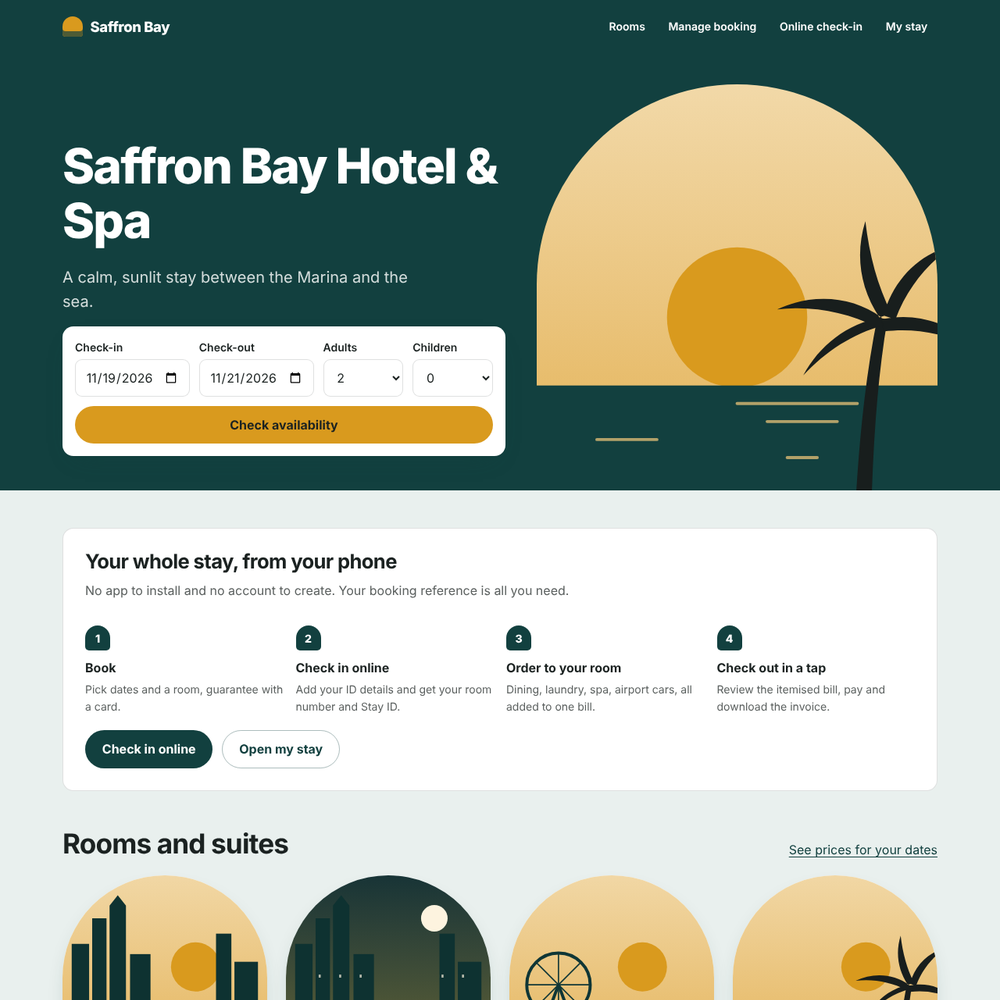
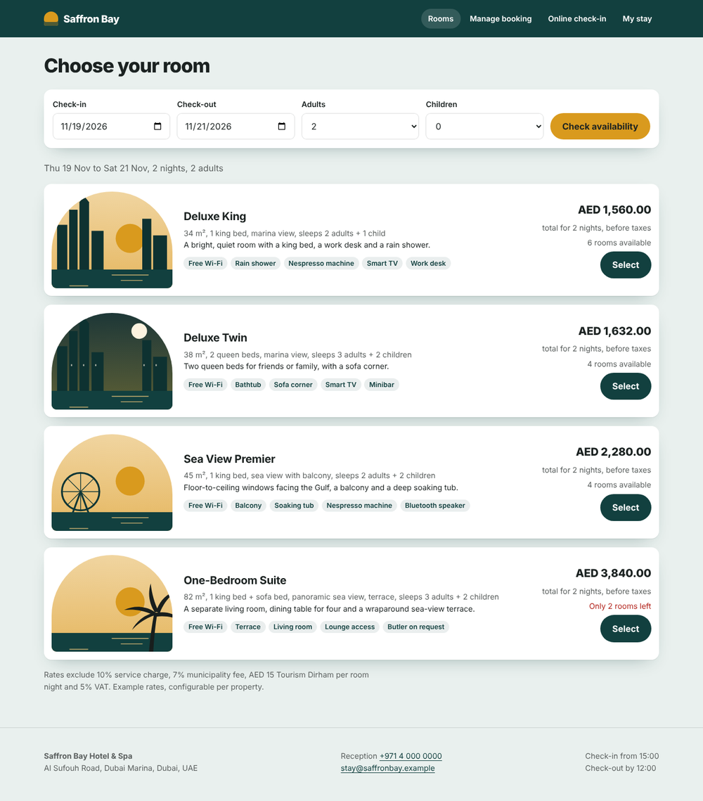
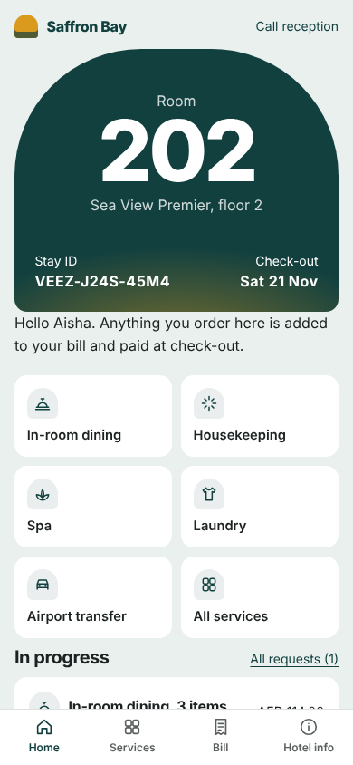
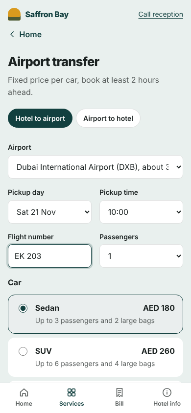
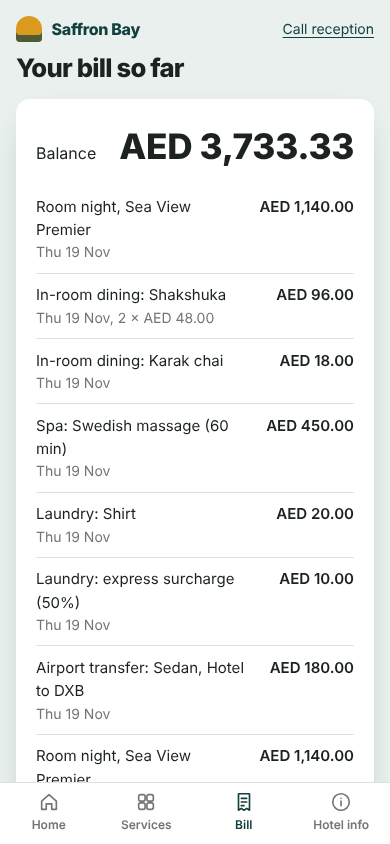
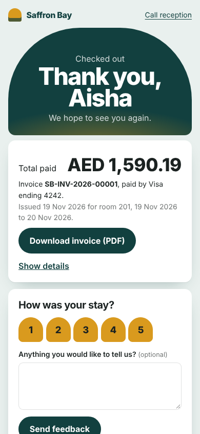
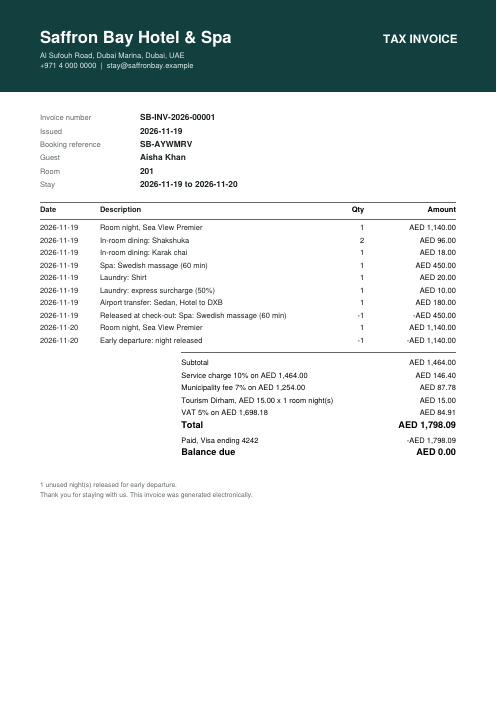

# 14. User guide

**Live app:** https://white-label-hms.onrender.com
**Test card:** `4242 4242 4242 4242`, expiry `12/29`, security code `123` (no money is taken)

Contents: [14.1 Guest guide](#141-guest-guide), [14.2 Five-minute demo script](#142-five-minute-demo-script), [14.3 Operator guide](#143-operator-guide), [14.4 FAQ](#144-faq-and-troubleshooting)

> The demo hotel is fictional. On the free hosting plan the site sleeps when unused; the first visit can take up to a minute, and data resets when the service restarts.

---

## 14.1 Guest guide

### Step 1: Find a room

On the home page, pick your **check-in** and **check-out** dates and the number of adults and children, then select **Check availability**.



Each room type shows its size, beds, view, amenities, the **total for your dates before taxes** and how many rooms are left. Thursday and Friday nights cost a little more. Select **Select** on the room you want.



### Step 2: Book

Enter your name, email and mobile number (and any special requests), then the card that guarantees the booking. **Nothing is charged now**; you pay at check-out. Tick the terms and select **Confirm booking**.


You get a **booking reference** such as `SB-VNJ9SW`. Keep it: with your last name it lets you check in, manage the booking and recover your Stay ID.


### Step 3: Manage or cancel (optional)

Use **Manage booking** in the top menu. Enter the reference and your last name to see the booking, cancel it (free until check-in) or, once checked in, open your stay if you lost your Stay ID.

### Step 4: Check in online

From the confirmation page, or **Online check-in** in the menu (opens on your arrival day):

1. Enter your booking reference and last name.
2. Add your nationality, document type (passport, Emirates ID or national ID) and document number, and your expected arrival time.
3. Confirm the details and select **Check in**.

You see your **room number** and your **Stay ID** (for example `SX2H-KXCU-WB4Y`). The Stay ID opens your in-stay app on any phone or computer, and it is remembered on this device. Select **Open my stay**, or **Copy link** to open it on your phone.


### Step 5: Use the in-stay app

The in-stay app is made for your phone. The **Home** tab shows your room, Stay ID and check-out date, quick buttons for the most used services, everything **in progress** with live status, and your **current bill**. The tab bar at the bottom switches between Home, Services, Bill and Hotel info.

<p>


</p>

Every order or booking shows a progress bar and its current status. In this demo each status moves on after about 10 seconds, and the screen updates by itself. You can **Cancel** a request until staff start on it (spa until 60 minutes before, transfers until 2 hours before); any charge is taken off your bill.

| Service | How to use it | Cost |
| --- | --- | --- |
| **In-room dining** | Filter by Breakfast, Starters, Mains, Desserts or Drinks; tap **+** to add items; the bar at the bottom shows the total; add allergies or preferences; **Place order**. Status: received → preparing → on the way → delivered | Menu prices |
| **Laundry** | Choose items and quantities, optionally **Express** (same day, +50%), pick a collection time, **Request pickup** | Price per item |
| **Housekeeping** | Clean my room, turndown, fresh towels, toiletries, water, change linen; **Send request** | Free |
| **Amenities** | Extra pillow or blanket, baby cot, bottle warmer, iron, adapter, charger, prayer mat | Free |
| **Report an issue** | Pick what is wrong (air conditioning, water, lights, TV/Wi-Fi, door, other), describe it, mark urgent if needed | Free |
| **Spa** | Choose a treatment, a day, then a free start time (taken times are crossed out); add notes; **Book treatment** | Treatment price |
| **Airport transfer** | Hotel to airport or airport to hotel, DXB or DWC, day and time, flight number, passengers, car type; **Book transfer** (at least 2 hours ahead) | Fixed price per car |
| **Hotel info** | Wi-Fi network and password (with **Copy**), opening hours, local guide with distances, house rules, reception numbers | — |

<p>



</p>
<p>


</p>

### Step 6: Check your bill

The **Bill** tab lists every room night and every order with its date, the subtotal, each tax (service charge 10%, municipality fee 7% on room and food, Tourism Dirham per night, VAT 5%) and your balance. Refunds appear in green with a minus sign.



### Step 7: Check out

Select **Check out** on the Home tab (or **Check out and pay** on the Bill tab).

- If you leave early, the app tells you that nights after tonight will be taken off, and that spa bookings not yet started and transfers booked for a later day will be refunded.
- Choose to pay with the card you booked with (shown as e.g. "Visa ending 4242") or a different card, then **Pay and check out**.

You then see the total paid and your invoice number. Select **Download invoice (PDF)** for a tax invoice, and rate your stay.

<p>


</p>



---

## 14.2 Five-minute demo script

For showing the app to a reviewer. Open the link a minute before. On the live demo each status moves on after 10 seconds.

| Time | Do | Point out |
| --- | --- | --- |
| 0:00 | Open the home page | The whole brand (name, colours, illustrations) comes from one config file |
| 0:20 | **Check availability** for today → 2 nights | Live availability per room type, weekend pricing, taxes stated up front |
| 0:50 | **Select** a room, fill details, test card, **Confirm booking** | Only card brand and last 4 digits are stored; double booking is impossible at the database level |
| 1:30 | **Check in online** → nationality, any document number → **Check in** | Room number and Stay ID; no account or password anywhere |
| 2:00 | **Open my stay** (ideally on your phone via **Copy link**) | Mobile-first app; the key card |
| 2:20 | **In-room dining** → add 2–3 items → **Place order** → back to Home | Cart, order status starts at "received" |
| 2:50 | **Spa** → pick a treatment and a time | Slots respect opening hours, 60-min notice and 3 treatment rooms |
| 3:20 | **Airport transfer** → try 5 passengers in a sedan, then fix it | Clear validation messages |
| 3:40 | Back to **Home** | Statuses have moved on by themselves, every 10 seconds (timer from env) |
| 4:00 | **Bill** | Every line and every tax, computed on the server, VAT on top of service charge |
| 4:20 | **Check out** → card on file → **Pay and check out** | Early-departure night and future spa refunded automatically; append-only bill |
| 4:45 | **Download invoice (PDF)**, rate 5 | Frozen invoice; the room goes back on sale |
| 5:00 | Close with the README and [docs](README.md) | HLD, LLD, schema, ADRs, tests |

---

## 14.3 Operator guide

### Re-brand the app or change prices

Everything property-specific is in [`config/hotel.json`](../config/hotel.json):

| Section | What it controls |
| --- | --- |
| `brand` | Name, short name, tagline, booking-code prefix (e.g. `SB`), colours (`primary`, `accent`, `surface`, `ink`, `primaryInk`) |
| `contact`, `checkInTime`, `checkOutTime` | Footer, reception links, policy text |
| `weekend` | Which nights are weekend nights and the price multiplier |
| `taxes` | Ordered list of percent taxes (with categories and compounding) and per-room-night fees |
| `wifi`, `hours`, `houseRules`, `localGuide` | Hotel info tab |
| `roomTypes` | Names, descriptions, rates, capacity, amenities and the room numbers of each type |
| `dining`, `laundry`, `amenities`, `housekeeping` | Catalogue items and prices (in fils: `4800` = AED 48.00) |
| `maintenanceCategories` | Issue categories |
| `spa` | Opening hours, slot length, number of treatment rooms, notice, treatments |
| `transfers` | Notice, airports with drive times, cars with seats and prices |

Example: make the main colour burgundy and the accent gold:

```json
"colors": { "primary": "#5b1a2b", "primaryInk": "#ffffff", "accent": "#c9a227", "surface": "#f1ecea", "ink": "#22191b" }
```

After editing: locally run `npm run seed:reset` and restart; on Render commit and push (the redeploy re-seeds). If the file has a mistake, the app refuses to start and the log names the field.

### Change how fast statuses move

| Variable | Meaning |
| --- | --- |
| `AUTO_ADVANCE_SECONDS` | Seconds each status lasts (default 10) |
| `AUTO_ADVANCE_SECONDS_FOOD`, `_LAUNDRY`, `_HOUSEKEEPING`, `_AMENITY`, `_MAINTENANCE`, `_SPA`, `_TRANSFER` | Per-service override |
| `AUTO_ADVANCE_ENABLED` | `false` freezes all statuses |
| `EARLY_CHECKIN_DAYS` | Let guests check in online N days before arrival |

Locally: put them in `.env` (copy `.env.example`). On Render: service → **Environment** → edit → **Save** (redeploys).

### Reset the demo

Locally `npm run seed:reset`; on Render restart the service (free plan) or set `RESET_DB_ON_START=true` for one deploy.

More operational tasks are in the [runbook](12-runbook.md).

---

## 14.4 FAQ and troubleshooting

| Question | Answer |
| --- | --- |
| The site takes a long time to open | The free server sleeps after 15 minutes without visitors; it wakes within about a minute |
| My booking disappeared | The demo data resets when the free server restarts; please book again |
| Check-in says it opens on a later date | Online check-in opens on the arrival day; book a stay starting today to try it |
| I lost my Stay ID | **Manage booking** → reference + last name → **Open my stay** |
| "Stay not found" | Check the Stay ID for typos (letters and numbers in three groups of four) |
| "Too many attempts" | Too many wrong codes from your network in a minute; wait for the time shown |
| I can't cancel an order | Orders can be cancelled only before staff start; spa up to 60 minutes and transfers up to 2 hours before |
| No spa times available | Times need 60 minutes' notice and there are 3 treatment rooms; try later or another day |
| My card was refused | Use the test card `4242 4242 4242 4242` with a future expiry such as `12/29` |
| Is any money taken? | No. Payments are simulated in this demo |
