# 14. User guide

**Live app:** https://white-label-hms.onrender.com
**Test card:** `4242 4242 4242 4242`, expiry `12/29`, security code `123` (no money is taken)

Contents: [14.1 Guest guide](#141-guest-guide), [14.2 Operator guide](#142-operator-guide), [14.3 FAQ](#143-faq-and-troubleshooting)

The demo hotel, Saffron Bay Hotel & Spa, is fictional. The demo runs on a free hosting plan; its data is cleared whenever I deploy a new version.

---

## 14.1 Guest guide

This section walks through the app the way a guest uses it, with screenshots from the running app.

### Step 1: Finding a room

The home page has a search panel with **check-in** and **check-out** dates and the number of adults and children. **Check availability** opens the results.


Each room type shows its size, beds, view, amenities, the **total for the chosen dates before taxes** and how many rooms are left. Thursday and Friday nights cost a little more. **Select** opens the booking form for that room.


### Step 2: Booking

The booking form asks for the guest's name, email, mobile number, optional special requests, and the card that guarantees the booking (its expiry has to be this month or later). **Nothing is charged at this point**; the guest pays at check-out. After accepting the terms, **Confirm booking, AED … before taxes** completes it. A room type that is sold out, or too small for the party, sends the guest back to the room list instead of the form.

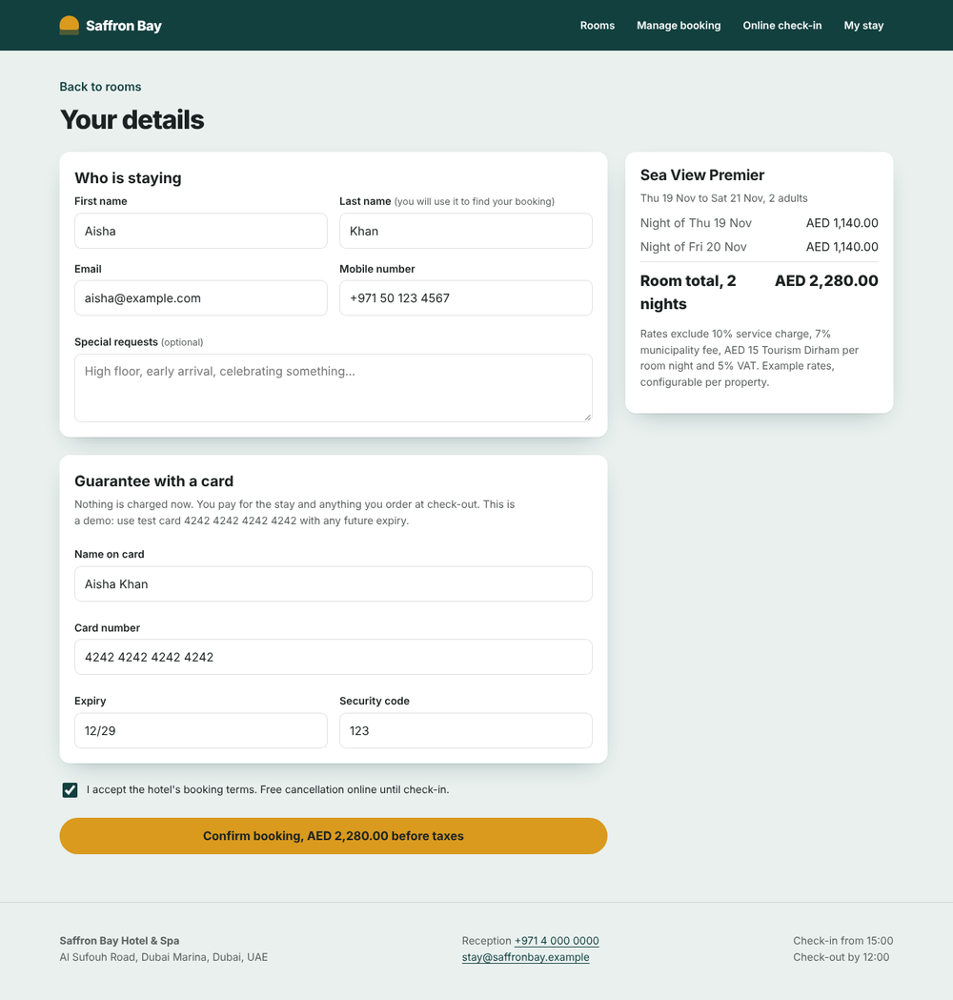

The confirmation shows a **booking reference** such as `SB-VNJ9SW`. With the last name, the reference opens online check-in, booking management and Stay ID recovery. Before online check-in opens, the **Check in online** button is greyed out and the opening date is shown.

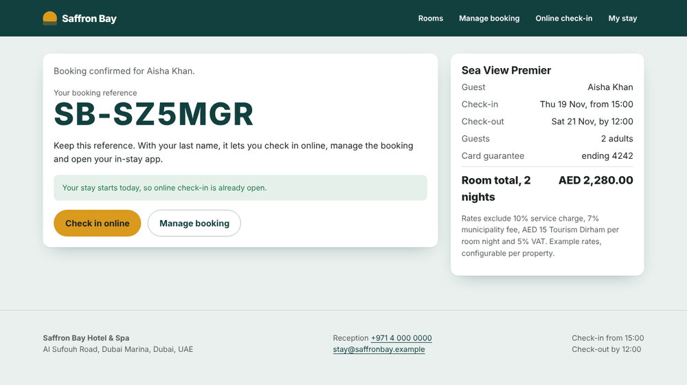

### Step 3: Managing or cancelling

**Manage booking** in the top menu takes the reference and last name and shows the booking. From there a guest cancels (free until check-in), reopens the stay after losing the Stay ID (**Open my stay**), or, after check-out, opens the invoice (**View invoice**).

### Step 4: Online check-in

Online check-in opens on the arrival day, from the confirmation page or **Online check-in** in the menu:

1. The guest enters the booking reference and last name.
2. The guest adds nationality, document type (passport, Emirates ID or national ID), document number and expected arrival time.
3. After confirming the details, **Check in** completes the step.

The result shows the **room number** and the **Stay ID** (for example `SX2H-KXCU-WB4Y`). The Stay ID opens the in-stay app on any phone or computer and is remembered on the device. **Open my stay** opens the app; **Copy link** copies its address for another device.

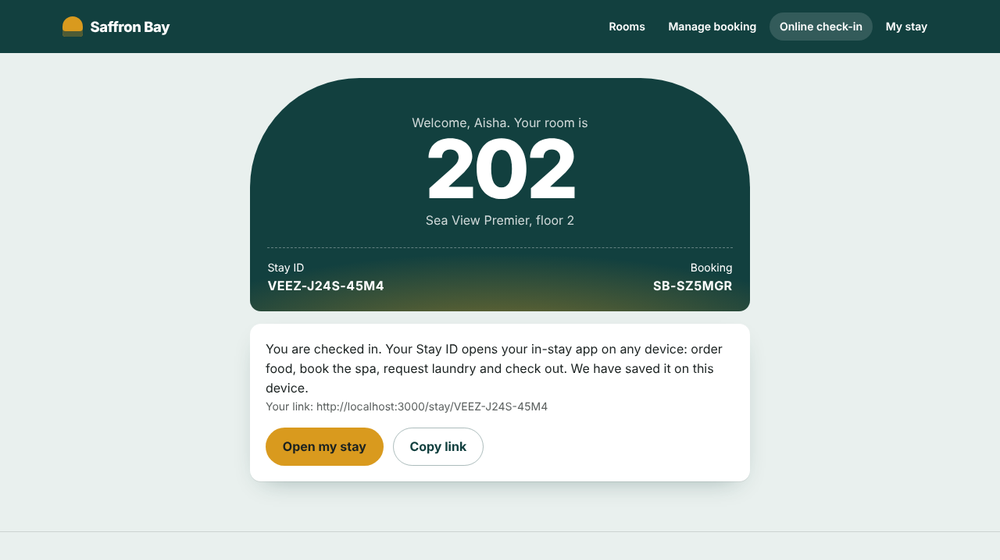

### Step 5: The in-stay app

The in-stay app is built for phones. The **Home** tab shows the room, Stay ID and check-out date, quick buttons for the most used services, everything **in progress** with live status, **upcoming** spa and transfer bookings, and the **current bill**. The tab bar switches between Home, Services, Bill and Hotel info.

<p>
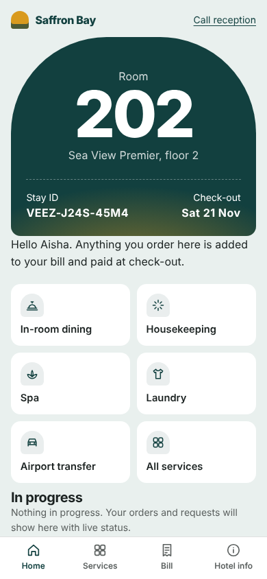

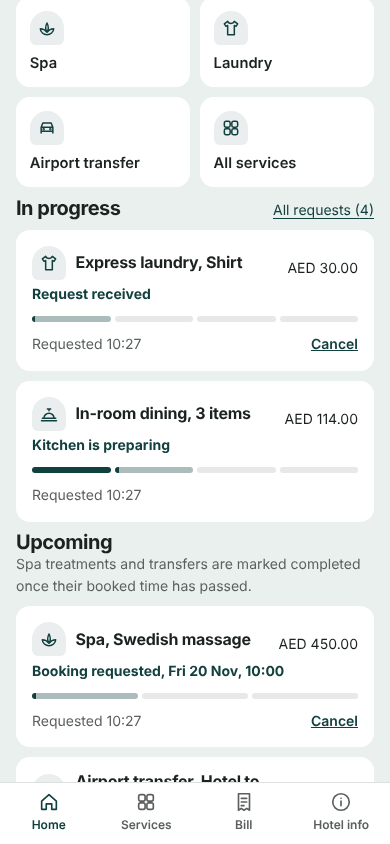
</p>

Every order or booking shows a progress bar and its current status. In this demo each status moves on after about 10 seconds, and the screen updates by itself. Spa treatments and airport transfers are confirmed within seconds but listed under **Upcoming** until their booked time; they are marked completed once that time has passed. A request can be cancelled until staff start on it (spa up to 60 minutes before, transfers up to 2 hours before); spa and transfer cancellations ask **Cancel this booking?** with **Yes, cancel** and **Keep it**. Any charge is removed from the bill. The status card shown right after ordering keeps updating as well.

On the last day, once check-out time (12:00) has passed, the app shows a notice and new orders and bookings are closed; the bill and check-out stay open. If the phone loses its connection, the app keeps showing the last details under a notice and updates again once the connection is back.

| Service | How it works | Cost |
| --- | --- | --- |
| **In-room dining** | Menu filtered by Breakfast, Starters, Mains, Desserts or Drinks; **+** adds items; the bar at the bottom shows the total; a notes field takes allergies or preferences; **Place order** sends it. Status: received → preparing → on the way → delivered | Menu prices |
| **Laundry** | Items and quantities, optional **Express** (same day, +50%), a collection time (only times still ahead today; after the last one, tomorrow's), then **Request pickup** | Price per item |
| **Housekeeping** | Clean my room, turndown, fresh towels, toiletries, water, change linen; **Send request** | Free |
| **Amenities** | Extra pillow or blanket, baby cot, bottle warmer, iron, adapter, charger, prayer mat | Free |
| **Report an issue** | A category (air conditioning, water, lights, TV/Wi-Fi, door, other), a description and an urgent flag | Free |
| **Spa** | A treatment, a day, then a free start time (taken times are crossed out; on the check-out day only treatments that end by 12:00), optional notes, then **Book treatment** | Treatment price |
| **Airport transfer** | Hotel to airport or airport to hotel, DXB or DWC, day and time, flight number, passengers and car type, then **Book transfer** (at least 2 hours ahead; the button stays greyed out while there are more passengers than seats; an airport pick-up has to be before the check-out day) | Fixed price per car |
| **Hotel info** | Wi-Fi network and password (with **Copy**), opening hours, local guide with distances, house rules, reception numbers | — |

<p>
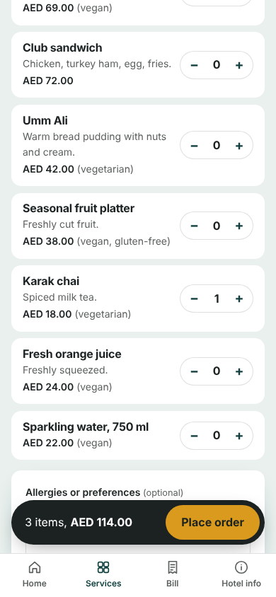
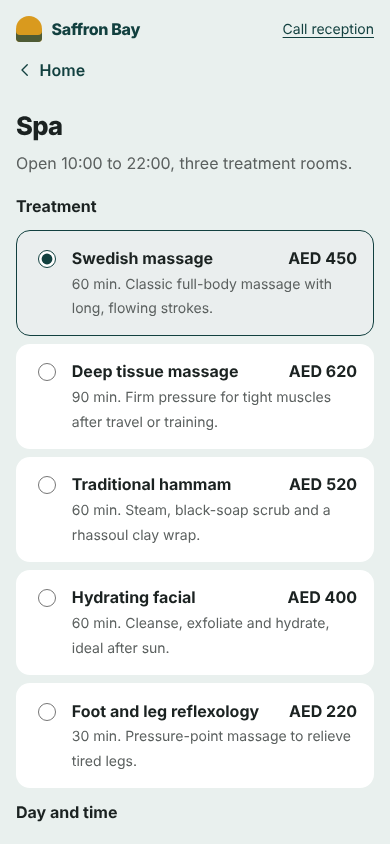

</p>
<p>
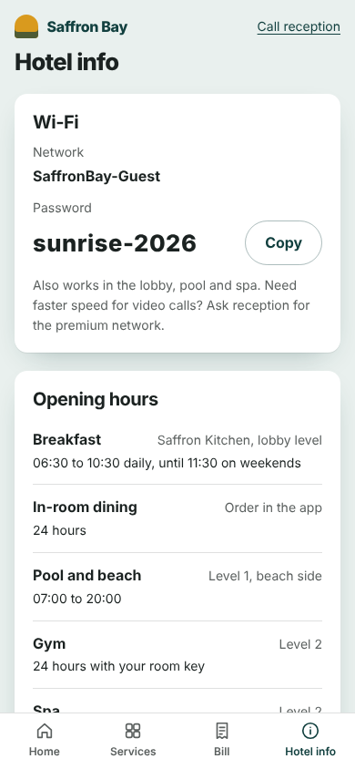
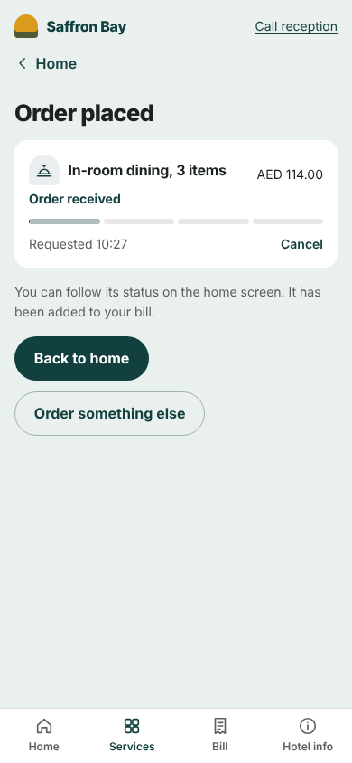
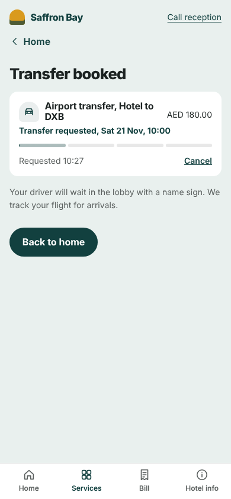
</p>

### Step 6: The bill

The **Bill** tab lists every room night and every order with its date, the subtotal, each tax (service charge 10%, municipality fee 7% on room and food, Tourism Dirham per night, VAT 5%) and the balance. Refunds appear in green with a minus sign.


### Step 7: Check-out

**Check out** on the Home tab (or **Check out and pay** on the Bill tab) opens check-out.

- The **Total due** is worked out by the server and is exactly the amount charged.
- For an early departure, the screen lists the unused nights that come off the bill (at least one night is always charged), and names each spa booking not yet started and each transfer booked for a later day that is cancelled and refunded.
- Payment uses the card from the booking (shown as e.g. "Visa ending 4242") or a different card; **Pay AED … and check out** completes it.

The thank-you page shows the total paid and the invoice number. **Download invoice (PDF)** produces the tax invoice, and the guest can rate the stay.

<p>
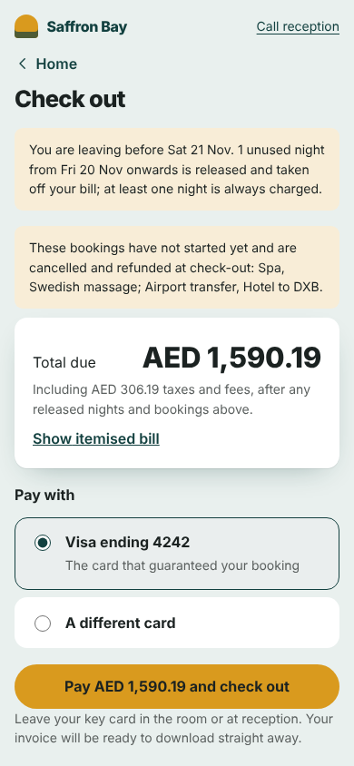

</p>


---

## 14.2 Operator guide

### Branding and prices

Everything property-specific is in [`config/hotel.json`](../config/hotel.json):

| Section | What it controls |
| --- | --- |
| `brand` | Name, short name, tagline, booking-code prefix (e.g. `SB`), colours (`primary`, `accent`, `surface`, `ink`, `primaryInk`) |
| `contact`, `checkInTime`, `checkOutTime` | Footer, reception links, policy text |
| `weekend` | Which nights are weekend nights and the price multiplier |
| `taxes` | Ordered list of percent taxes (with categories and compounding) and per-room-night fees |
| `wifi`, `hours`, `houseRules`, `localGuide` | Hotel info tab |
| `roomTypes` | Names, descriptions, rates, capacity, amenities and the room numbers of each type |
| `dining`, `laundry`, `amenities`, `housekeeping` | Catalogue items and prices (in fils: `4800` = AED 48.00) |
| `maintenanceCategories` | Issue categories |
| `spa` | Opening hours, slot length, number of treatment rooms, notice, treatments |
| `transfers` | Notice, airports with drive times, cars with seats and prices |

For example, this block gives the hotel a burgundy and gold palette:

```json
"colors": { "primary": "#5b1a2b", "primaryInk": "#ffffff", "accent": "#c9a227", "surface": "#f1ecea", "ink": "#22191b" }
```

Locally a change takes effect after `npm run seed:reset` and a restart; on Render, after a commit and push (the redeploy re-seeds). A mistake in the file stops the app at start-up, and the log names the field.

### Status speed

| Variable | Meaning |
| --- | --- |
| `AUTO_ADVANCE_SECONDS` | Seconds each status lasts (default 10) |
| `AUTO_ADVANCE_SECONDS_FOOD`, `_LAUNDRY`, `_HOUSEKEEPING`, `_AMENITY`, `_MAINTENANCE`, `_SPA`, `_TRANSFER` | Per-service override |
| `AUTO_ADVANCE_ENABLED` | `false` freezes all statuses |
| `EARLY_CHECKIN_DAYS` | Opens online check-in N days before arrival |

Locally these live in `.env` (template in `.env.example`); on Render, under the service's **Environment**, where saving triggers a redeploy.

### Demo reset

Locally `npm run seed:reset`; on Render **Restart service** (the free plan has no disk) or one deploy with `RESET_DB_ON_START=true`.

The [runbook](12-runbook.md) covers the remaining operational tasks.

---

## 14.3 FAQ and troubleshooting

| Question | Answer |
| --- | --- |
| Why does the site take a while to open? | Right after a new version is deployed, the free server takes up to a minute to start |
| Where did a booking or stay go? | The demo data is cleared when a new version is deployed; the in-stay app says so when it can't find a stay |
| Why does check-in say it opens on a later date? | Online check-in opens on the arrival day; a stay starting today can check in straight away |
| What if the Stay ID is lost? | **Manage booking** with the reference and last name shows **Open my stay** |
| What does "We could not find a stay with the ID …" mean? | The Stay ID has a typo (it is letters and numbers in three groups of four) or the data was reset |
| What does "Too many attempts" mean? | Too many booking references or Stay IDs that do not exist were tried from one network in a minute; lookups work again after the time shown, and a Stay ID that already opened keeps working |
| Why can't anything be ordered on the last afternoon? | New orders and bookings close at check-out time (12:00) on the check-out day; reception extends stays |
| Why can't an order be cancelled? | Orders can be cancelled only before staff start; spa up to 60 minutes and transfers up to 2 hours before |
| Why are there no spa times? | Times need 60 minutes' notice and there are 3 treatment rooms; later times or other days have space |
| Why was a card refused? | The demo accepts the test card `4242 4242 4242 4242` with an expiry from the current month on, such as `12/29` |
| Is any money taken? | No. Payments are simulated in this demo |
